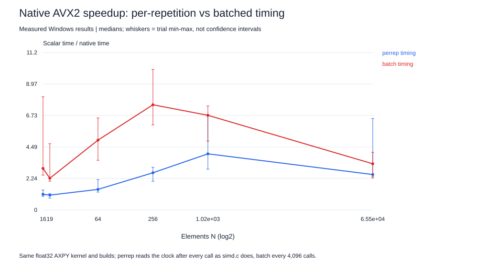

# Timer overhead at small N (Project 1 sub-study)

**Question.** In the main SIMD suite, AVX2 gives 4.5x over scalar at N=1,024 but almost nothing at N=16-19 (about 2 ns/element for every build). Is that a property of the kernel, or of the measurement?

**Method.** [`timer_overhead.c`](timer_overhead.c) copies the AXPY kernel and the `now()` function verbatim from [`simd.c`](../src/simd.c) and times the same kernel two ways: `perrep` reads the clock after every call, exactly like `simd.c`; `batch` reads it once per 4,096 calls. A third mode measures one `now()` call by itself. Float32 builds with the main suite's flags (scalar `-fno-tree-vectorize`, auto, native `-march=native`, all `-O3 -ffp-contract=off`; gcc.EXE (GCC) 16.2.0), pinned to CPU0, 0.2 s windows, 5 trials per condition in a shuffled order, outputs checked against a reference before timing. [Predictions](HYPOTHESES.md) were written before collection; [raw results](results.jsonl). Run by Claude Code (see the AI-use note).

**Timer cost.** One `now()` call (QueryPerformanceCounter plus QueryPerformanceFrequency) costs **21.1 ns** (median of 5 trials, range 20.3-23.1).

| N | Per-rep scalar ns/elem | Per-rep native ns/elem | Per-rep speedup | Batched scalar ns/elem | Batched native ns/elem | Batched speedup | Per-rep minus batched, ns/rep (scalar) | Timer share of a scalar per-rep repetition | Main suite native ns/elem |
|---:|---:|---:|---:|---:|---:|---:|---:|---:|---:|
| 16 | 2.112 | 1.894 | 1.12x | 0.435 | 0.147 | **2.96x** | 26.8 | 63% | 1.928 |
| 19 | 1.797 | 1.697 | 1.06x | 0.347 | 0.154 | **2.26x** | 27.5 | 62% | 1.723 |
| 64 | 0.738 | 0.504 | 1.46x | 0.326 | 0.065 | **4.97x** | 26.4 | 45% | - |
| 256 | 0.385 | 0.145 | 2.65x | 0.323 | 0.043 | **7.49x** | 15.8 | 21% | - |
| 1,024 | 0.299 | 0.075 | 4.00x | 0.267 | 0.040 | **6.74x** | 32.6 | 7% | 0.065 |
| 65,536 | 0.310 | 0.123 | 2.52x | 0.400 | 0.122 | **3.29x** | -5873.8 | 0% | 0.121 |

**Finding.** At N=16 the per-repetition method reports 2.11 versus 1.89 ns/element (scalar versus native, 1.12x), but the same kernels timed in batches take 0.435 versus 0.147 ns/element, a **3.0x** AVX2 speedup. For N=16-1,024 the per-repetition minus batched difference is 16-33 ns per repetition, comparable to one `now()` call (21 ns) plus a little loop bookkeeping, so at small N the main suite largely measured its own clock.

**The in-cache headline speedup is understated too.** The timer hurts the vector build more than scalar, because vector repetitions are shorter: at N=1,024 a native repetition takes about 77 ns, so 21 ns of timer is about 28% of it, against 7% of a scalar repetition. Batched timing gives **6.7x** at N=1,024, where the per-repetition method gives 4.0x; the main suite reported 4.5x for the same kernel and size. The main suite's in-L1 speedups are therefore conservative, and the conclusion that SIMD gains compress from cache to DRAM is, if anything, understated.

**Large N.** At N=65,536 a repetition takes tens of microseconds and the timer is negligible. Auto and native agree between methods; the scalar results are noisy in both (per-repetition 0.296-0.778, batched 0.321-0.493 ns/element), so the ranges overlap and the large negative difference in the table is noise, not a timer effect. Background CPU load was 12-26% when this run started.

**Consequence for the alignment/tail study.** The main suite's N=16/19 rows (aligned versus shifted, divisible versus remainder) differ by a few percent, but the timer is about 60% of each measured scalar repetition at those sizes. Those rows cannot resolve prologue/epilogue costs of a few cycles; the N=65,536/65,539 rows are the meaningful alignment and tail comparison. This is a benchmark pitfall: an innocent-looking timing loop hides a 2-7x SIMD effect at small sizes.

**Fix (not applied to the committed suite, to keep data and code consistent):** read the clock every K repetitions (as `batch` does), and cache `QueryPerformanceFrequency`, which never changes while the system runs.
