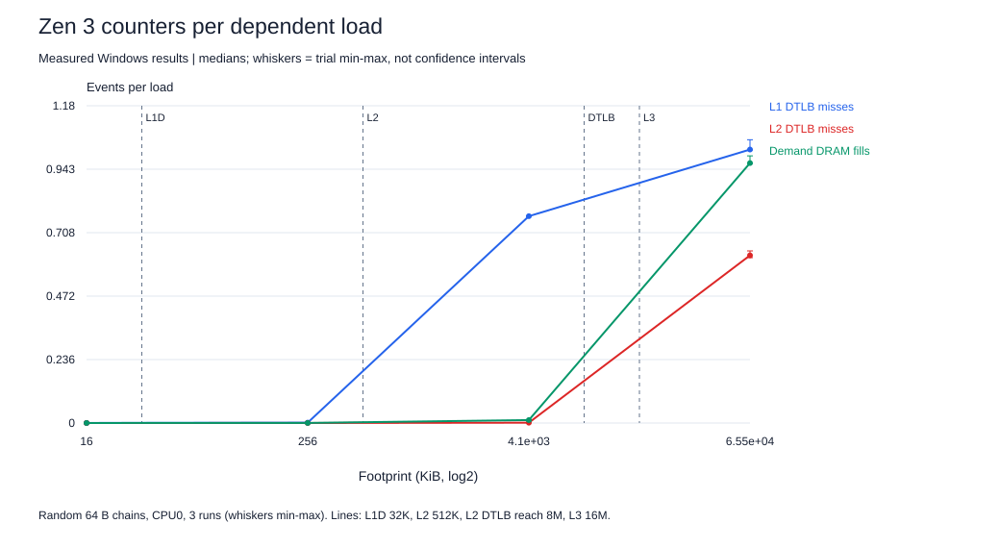
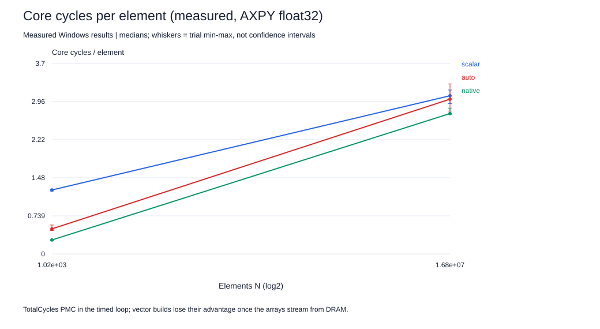

# Hardware-counter results (AMD Zen 3, Ryzen 5 5500)

This closes the cache/TLB-correlation and core-cycles-per-element gaps that earlier revisions left open. Every value below is a measured count from the AMD core PMU, captured with Windows Performance Recorder during the same benchmark runs whose timings are listed. Nothing is inferred from timing alone.

## How the counts were obtained

- **Capture:** `wpr` with the strict profile [`counters-zen3.wprp`](counters/counters-zen3.wprp) recorded five PMCs on every context switch (CSwitch) while each benchmark ran pinned to CPU0. 54 runs: six memory conditions and twelve SIMD conditions, three repetitions each, three seconds per run.
- **Export:** [`common/export-pmc.c`](../../common/export-pmc.c) reads the ETL through the Windows ETW API and keeps CPU0 context switches. Export reported zero lost events and zero lost buffers. The 500 MB ETL stays local because it contains unrelated system activity; its SHA-256 is in [`counters/etl-sha256.txt`](counters/etl-sha256.txt).
- **Attribution:** for each run, only scheduling intervals in which the benchmark's own thread ran on CPU0 are summed. The **lower** bound uses intervals completely inside the QPC timing window; the **upper** bound adds the two edge intervals. Tables use the lower bound; both are in [`counters.json`](counters.json). The thread was scheduled for at least 84.4% of every timing window.
- **Normalization:** memory counts are per dependent load (`operations`); SIMD counts are per processed element (`n x reps`). Loop, timer and stop-check overhead are included, initialization and validation are not.

### Identifying the counter order

Windows did not report the order in which it recorded the five counters (`counter-order.txt`: query error 24), which is why the previous revision stopped here. Rather than guess, [`analyze-pmc.py`](../../common/analyze-pmc.py) derives the order from physical invariants and fails if any invariant does not hold:

1. TotalCycles = column 4: the only counter whose rate stays between 2 and 5.5 G/s with <6% spread across all 54 workloads (memory chains and SIMD alike); a clock is workload-independent.
2. InstructionRetired = column 0: largest non-clock count per L1-resident load, and per-element counts for each SIMD build are size-independent (within 10% between N=1,024 and N=16,777,216) because the same loop body executes.
3. LabL1DTLBMiss = column 2: the 4 MiB chain touches 1,024 pages, more than the 64-entry L1 DTLB but fewer than the 2,048-entry L2 DTLB and with data resident in the 16 MiB L3, so it is the only remaining counter that is high there.
4. LabL2DTLBMiss = column 3: high for the scattered chain (16,384 pages, beyond the 8 MiB L2 DTLB reach) and near zero for the 4 MiB chain; it never exceeds column 2 in any memory run, as required because unit mask 0xF0 is a subset of 0xFF.
5. LabDemandDRAMFill = column 1: about one event per load for the 64 MiB chain, but low for the scattered chain, whose 1 MiB of touched lines fits in cache even though its pages do not fit the TLB, and near zero in L1.

Recovered order: `InstructionRetired, LabDemandDRAMFill, LabL1DTLBMiss, LabL2DTLBMiss, TotalCycles`.

## Project 2: cache and TLB correlation

| Condition | ns/load [min,max] | Core cycles/load [min,max] | Core GHz | L1 DTLB miss/load | L2 DTLB miss/load | DRAM fill/load |
|---|---|---|---:|---:|---:|---:|
| 16 KiB | 0.99 [0.99, 1.00] | 4.2 [4.1, 4.2] | 4.22 | 0.0003 | 0.0000 | 0.0001 |
| 256 KiB | 3.11 [3.04, 3.26] | 13.0 [12.6, 13.6] | 4.22 | 0.0014 | 0.0002 | 0.0003 |
| 4 MiB | 14.02 [13.57, 14.15] | 58.5 [57.0, 58.9] | 4.22 | 0.7688 | 0.0012 | 0.0110 |
| 64 MiB | 122.01 [121.74, 130.72] | 507.9 [505.9, 541.0] | 4.22 | 1.0165 | 0.6231 | 0.9662 |
| 1 MiB, 64 B spacing | 10.45 [9.80, 10.56] | 43.1 [41.2, 43.7] | 4.22 | 0.2418 | 0.0008 | 0.0016 |
| 64 MiB, 4 KiB spacing | 23.48 [21.11, 32.95] | 97.7 [88.4, 123.6] | 4.22 | 0.9949 | 0.6621 | 0.0396 |

**What the counters show:**

- **L1 is about 4.2 cycles per load.** Zen 3's documented L1D load-to-use latency is 4 cycles for simple addressing, so the 16 KiB chain is an L1 measurement, and the timer agrees with the cycle counter (0.99 ns x 4.22 GHz = 4.20 cycles). This independently validates the timing method.
- **L2 is about 13.0 cycles** (documented: 12) with essentially no TLB misses: 256 KiB is 64 pages, exactly the L1 DTLB reach.
- **The 4 MiB "LLC" point costs 58.5 cycles but is not a pure L3 latency:** 0.77 L1 DTLB misses per load (1,024 pages against a 64-entry L1 DTLB) add L2-TLB lookups to most loads. L2 DTLB misses stay near zero because 1,024 pages fit its 2,048 entries, and DRAM fills are only 0.011/load, so data really comes from L3.
- **The 64 MiB chain is DRAM-bound:** 0.97 demand DRAM fills and 0.62 L2 DTLB misses (page walks) per load, costing about 508 cycles per load.

### AMAT-style decomposition

Using the counted DRAM-fill rate as the miss probability, a two-level model `cycles/load = t_hit + m_DRAM x penalty` fitted to the LLC and DRAM candidates gives **t_hit = 53.4 cycles** and **penalty = 470 cycles (111 ns at 4.22 GHz)**. The penalty absorbs the page walks that co-occur with DRAM misses in the 64 MiB chain, so it is a "DRAM plus translation" penalty rather than pure DRAM access time.

**Anomaly retained:** a capacity-only model predicts that about 25% of a 64 MiB random footprint stays in the 16 MiB L3 (miss rate 0.75), but the counters show 0.97 demand DRAM fills per load. Plausible contributors: Zen 3's L3 is a non-inclusive victim cache filled by L2 evictions rather than demand fills, page-table lines compete for the same capacity, and other processes share the L3. The event also counts I/O fills, and may count page-walk fills; the counter definition alone cannot separate these.

### TLB impact: same nodes, different pages

`packed-pages` and `scattered-pages` both chase **16,384 nodes** in random order; only the spacing changes (64 B, i.e. 256 pages, versus 4 KiB, i.e. 16,384 pages). The counters confirm the intended effect: L2 DTLB misses rise from 0.0008 to 0.66 per load, and L1 DTLB misses from 0.24 to 0.99. Time per load rises from 43.1 to 97.7 cycles.

Dividing the extra cycles by the extra L2 DTLB misses gives an upper bound of **83 cycles per page walk**. Removing the small DRAM-fill increase (0.002 to 0.040/load, at the fitted 470-cycle penalty) gives about **56 cycles per walk**, consistent with walks whose page-table entries hit in the L2/L3 caches. **Remaining confound:** 4 KiB spacing also maps every node to the same L1/L2 set index, so set-conflict misses could contribute; there was no L2-miss counter in this five-counter profile to exclude them. The AMAT model with no TLB term predicts 72 cycles for the scattered chain; the measured 98 leaves the remainder for translation and set conflicts.

## Project 1: measured core cycles per element

All twelve conditions use kernel 0 (out-of-place AXPY, `z = 1.25x + y`, FMA contraction off). TSC ticks run at a fixed reference rate and are not core cycles; both are shown so the difference is visible.

| Type | Build | N | Core cycles/element [min,max] | Instr/element | IPC | TSC ticks/element | Core GHz | DRAM fill/element | GFLOP/s |
|---|---|---:|---|---:|---:|---:|---:|---:|---:|
| float | scalar | 1,024 | 1.242 [1.220, 1.260] | 7.071 | 5.69 | 1.076 | 4.23 | 0.0000 | 6.68 |
| float | scalar | 16,777,216 | 3.071 [2.918, 3.182] | 7.012 | 2.29 | 2.637 | 4.22 | 0.0038 | 2.72 |
| float | auto | 1,024 | 0.487 [0.455, 0.562] | 2.100 | 4.31 | 0.429 | 4.21 | 0.0000 | 16.76 |
| float | auto | 16,777,216 | 3.005 [2.775, 3.301] | 2.060 | 0.69 | 2.634 | 4.21 | 0.0087 | 2.73 |
| float | native | 1,024 | 0.272 [0.266, 0.272] | 0.848 | 3.12 | 0.233 | 4.22 | 0.0000 | 30.81 |
| float | native | 16,777,216 | 2.726 [2.712, 2.833] | 0.778 | 0.29 | 2.335 | 4.22 | 0.0642 | 3.08 |
| double | scalar | 1,024 | 1.185 [1.181, 1.189] | 7.064 | 5.96 | 1.017 | 4.23 | 0.0000 | 7.07 |
| double | scalar | 16,777,216 | 5.520 [5.459, 5.749] | 7.049 | 1.28 | 4.743 | 4.22 | 0.0097 | 1.52 |
| double | auto | 1,024 | 0.763 [0.752, 0.776] | 4.087 | 5.35 | 0.662 | 4.22 | 0.0000 | 10.85 |
| double | auto | 16,777,216 | 5.775 [5.740, 5.921] | 4.081 | 0.71 | 5.016 | 4.22 | 0.0143 | 1.43 |
| double | native | 1,024 | 0.435 [0.406, 0.472] | 1.595 | 3.67 | 0.377 | 4.22 | 0.0000 | 19.08 |
| double | native | 16,777,216 | 6.561 [6.457, 7.072] | 1.678 | 0.25 | 6.017 | 4.20 | 0.1100 | 1.19 |

**What the counters show:**

- **Vectorization is confirmed by instruction counts.** Float32 scalar AXPY retires 7.07 instructions per element; the AVX2 build retires 0.85, an 8.3x reduction that matches 8 float lanes per 256-bit instruction plus loop overhead amortized over the unrolled body.
- **In cache, the speedup is a cycle-count speedup:** 1.242 versus 0.272 cycles/element (4.57x) at nearly the same clock.
- **The scalar baseline is dispatch-bound, not arithmetic-bound.** In L1 the scalar builds run at 5.7-6.0 IPC, close to Zen 3's 6-wide dispatch (the compare-and-branch pair fuses, so 7 instructions are about 6 macro-ops). One element per ~1.2 cycles is the front-end limit, so SIMD wins in cache mainly by issuing fewer instructions, not by doing arithmetic faster.
- **From DRAM, the vector advantage disappears** (3.07 versus 2.73 cycles/element) even though the vector build still executes 9.0x fewer instructions. IPC of the native build drops from 3.12 to 0.29: the core is idle, waiting for data. This is the memory-bound regime of the roofline, measured directly rather than inferred.
- **Bandwidth consistency check:** 12 useful bytes per element at 2.73 cycles/element is 4.40 B/cycle, i.e. 18.6 GB/s at 4.22 GHz, in line with the separately measured two-read/one-write streaming reference (about 16-18 GB/s).
- **Negative case explained by counters:** for float64 from DRAM the AVX2 build is *slower* than scalar (6.56 versus 5.52 cycles/element) and incurs 11x more demand DRAM fills per element (0.110 versus 0.0097). The wider loop consumes cache lines faster than the hardware prefetcher stays ahead, so more loads wait for demand fills. Wider vectors cannot help, and can hurt, once the stream is limited by prefetch and DRAM.
- **Clock:** the core ran at a median 4.22 GHz under load, essentially the 5500's rated 4.2 GHz maximum boost, so the roofline compute ceiling can now use a measured clock instead of 2/3/4 GHz scenarios: two 256-bit FMA pipes give 32 FP32 FLOP/cycle, **135 GFLOP/s** with FMA; this build disables FMA contraction. For AXPY in L1 the tighter limit is memory ports: each 8-element vector needs two 256-bit loads and one 256-bit store, so at one 256-bit store per cycle the floor is about 0.125 cycles/element. The measured 0.272 is 46% of that port bound.

Demand DRAM fills per element stay small even for DRAM-resident arrays because sequential streams are brought in by the hardware prefetcher, and prefetch fills are not demand fills. That is why this event says little about streaming kernels and why the memory-chain conditions are the right place to use it.

## Limits

- Five events at a time (six programmable sources were listed; one was left free). No L2-miss or L3-miss counter was recorded, so L2 versus L3 hit rates are inferred from footprint rather than counted.
- Counts are attributed per context-switch interval, not per instruction. Edge intervals are bounded, not split.
- Three runs per condition. Medians and min/max are reported; these are not confidence intervals.
- Counter definitions follow the Linux perf Zen 3 event table (see [Zen 3 counter notes](../../project-2-memory/docs/ZEN3-COUNTERS.md)); speculative counts are possible for TLB events.
