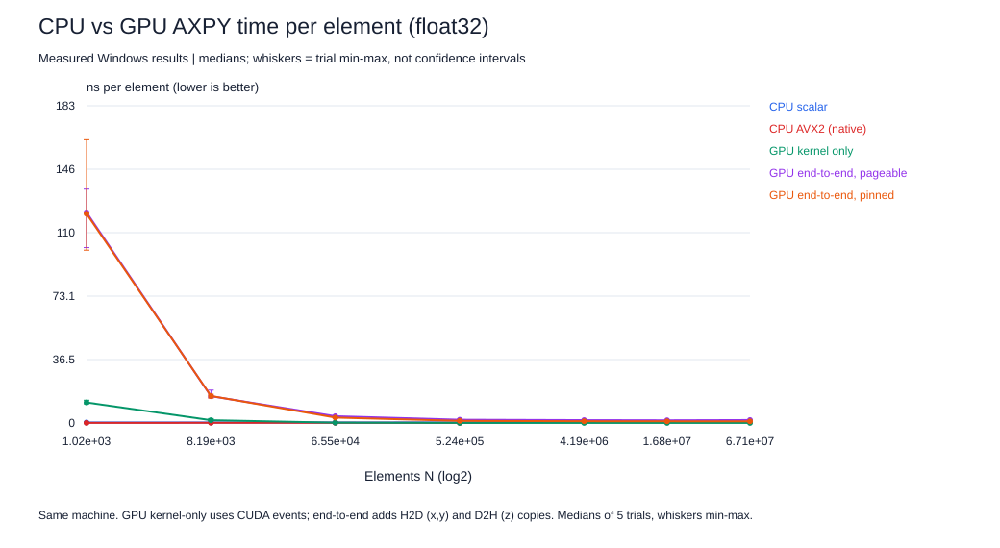

# Optional GPU extension: CPU vs GPU AXPY

Device: **NVIDIA GeForce GTX 1660 Ti** (24 SMs, 192-bit memory, 288 GB/s theoretical), CUDA runtime 12090, driver 13040, CuPy 14.2.0. Same host as the CPU results (Ryzen 5 5500, PCIe 3.0). [Predictions](gpu/HYPOTHESES.md) were written before collection; [raw results](gpu/results.jsonl).

The GPU computes exactly the CPU kernel, out-of-place `z = 1.25x + y` in float32, and every result is checked bit-for-bit against a NumPy reference (inputs are binary fractions, so the result is exact). **Kernel-only** time is measured with CUDA events around back-to-back launches. **End-to-end** time is wall-clock for copying x and y to the device, running the kernel, and copying z back, into preallocated device buffers; it is reported for ordinary (pageable) and page-locked (pinned) host memory. CPU numbers are the native AVX2 build from this session's SIMD suite.

| N | CPU AVX2 ns/elem | GPU kernel ns/elem [min,max] | GPU kernel GB/s | E2E pageable ns/elem | E2E pinned ns/elem | Pinned H2D / D2H GB/s | CPU-to-GPU speedup: kernel / E2E pinned |
|---:|---:|---|---:|---:|---:|---:|---:|
| 1,024 | 0.065 |11.8166 [11.0438, 13.1094] | 1.0 | 121.289 | 120.508 | 0.2 / 0.1 | 0.01x / 0.00x |
| 8,192 | 0.102 |1.5991 [1.4084, 2.5442] | 7.5 | 15.430 | 15.552 | 1.8 / 0.9 | 0.06x / 0.01x |
| 65,536 | 0.121 |0.1884 [0.1748, 0.2042] | 63.7 | 3.912 | 3.110 | 7.6 / 3.9 | 0.64x / 0.04x |
| 524,288 | 0.113 |0.0550 [0.0543, 0.0571] | 218.2 | 1.875 | 1.228 | 12.4 / 9.7 | 2.06x / 0.09x |
| 4,194,304 | 0.651 |0.0501 [0.0499, 0.0524] | 239.6 | 1.646 | 1.021 | 12.9 / 12.2 | 13.00x / 0.64x |
| 16,777,216 | 0.705 |0.0506 [0.0498, 0.0548] | 237.2 | 1.556 | 0.980 | 13.2 / 12.9 | 13.93x / 0.72x |
| 67,108,864 | not run |0.0496 [0.0489, 0.0564] | 242.0 | 1.694 | 0.964 | 13.2 / 13.1 | n/a (no CPU run) |

**When the GPU helps:** with data already resident on the device, a large AXPY runs at 237 GB/s (82% of theoretical), 14x faster per element than the CPU's DRAM-limited AVX2 loop at the same N. That is the situation of a longer GPU pipeline where data stays on the card between kernels.

**When it fails:** (1) at small N, a single launch costs about 12.1 us regardless of work, so the in-cache CPU is far faster; (2) end-to-end, AXPY does only 2 FLOPs per 12 bytes, and the bytes must cross PCIe. At N=16,777,216 with pinned memory, copies are 94% of the GPU-side time, and the end-to-end path is limited by PCIe bandwidth, which is lower than the CPU's own DRAM bandwidth. Offloading a single low-intensity kernel therefore loses, the same roofline argument as on the CPU with PCIe as the narrowest link.

**Limits:** one kernel, one GPU; pageable-copy timing includes the driver staging copy; the GPU clock is not locked; CuPy adds Python launch overhead that a native CUDA program would reduce (kernel-only timing with back-to-back launches minimizes but does not remove it). This extension is optional and not used for any required rubric item.
