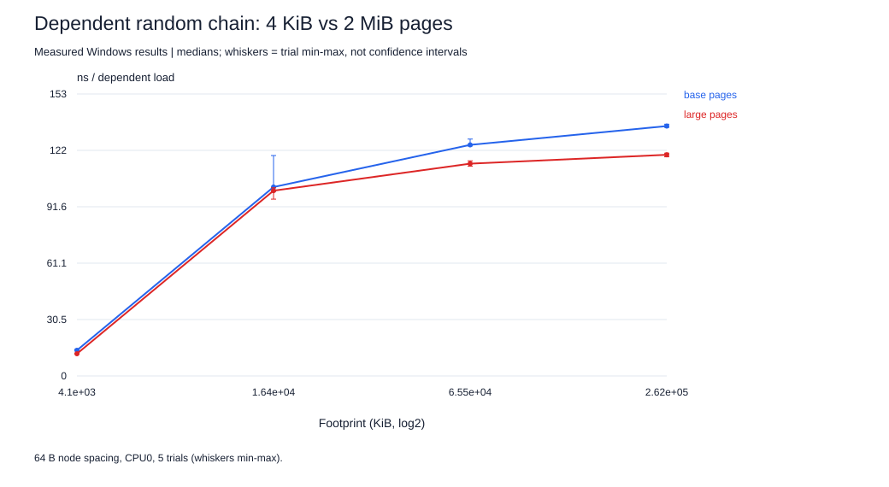

# Large pages: 4 KiB versus 2 MiB

Same Ryzen 5 5500 host. Windows large pages (2 MiB, `VirtualAlloc` with `MEM_LARGE_PAGES` after enabling `SeLockMemoryPrivilege`) versus ordinary 4 KiB pages, for the same dependent random-chain benchmark (`membench.c` with the optional `large` argument). 60 runs, 5 trials per condition in a shuffled order, 1 s each, pinned to CPU0; each chain is verified as a single cycle before timing and its end position is checked after. [Predictions](large-pages/HYPOTHESES.md) were written before collection; [raw results](large-pages/results.jsonl).

| Condition | Footprint KiB | 4 KiB pages ns/load [min,max] | 2 MiB pages ns/load [min,max] | Time saved by 2 MiB pages | L2-DTLB misses/load with 4 KiB pages (counters) |
|---|---:|---|---|---:|---:|
| packed 16,384 nodes, 64 B | 1,024 | 10.59 [10.27, 11.24] | 9.70 [9.64, 10.18] | +8.4% | 0.001 |
| scattered 16,384 nodes, 4 KiB | 65,536 | 24.44 [22.19, 26.97] | 18.89 [15.56, 34.55] | +22.7% | 0.662 |
| 4 MiB | 4,096 | 13.88 [13.82, 14.40] | 12.02 [11.99, 12.14] | +13.4% | 0.001 |
| 16 MiB | 16,384 | 102.28 [99.88, 119.34] | 100.32 [95.72, 101.92] | +1.9% | - |
| 64 MiB | 65,536 | 125.11 [124.53, 128.25] | 114.94 [113.59, 116.46] | +8.1% | 0.623 |
| 256 MiB | 262,144 | 135.29 [134.61, 136.31] | 119.75 [118.63, 120.63] | +11.5% | - |

**Separating TLB misses from set conflicts.** With 4 KiB pages the scattered chain is 13.9 ns/load slower than the packed chain over the same 16,384 nodes; with 2 MiB pages the gap shrinks to 9.2 ns. Large pages remove the page walks (0.66 per load with base pages) but keep the 4 KiB spacing, so about **34%** of the gap is attributable to translation. Treat that as a **lower bound**: the L1D is indexed by address bits inside a 4 KiB page, so it aliases equally under both page sizes, but the L2 is physically indexed. With 2 MiB pages, physically contiguous memory makes all 16,384 nodes fall into the same L2 sets, whereas scattered 4 KiB frames spread them out. Set conflicts are therefore at least as bad in the large-page run. The scattered large-page trials also vary widely (15.6-34.6 ns), so the split is approximate. This narrows, but does not fully resolve, the confound from the counter analysis.

The packed chain also gains (10.59 to 9.70 ns) despite having almost no L2-DTLB misses: its 256 pages overflow the 64-entry L1 DTLB (0.24 L1-DTLB misses per load in the counter run), and with 2 MiB pages one L1-DTLB entry covers the whole chain.

**Footprint sweep.** 4 MiB: 13.9 to 12.0 ns/load (ranges do not overlap). 16 MiB: 102.3 to 100.3 ns/load (ranges overlap: no clear difference). 64 MiB: 125.1 to 114.9 ns/load (ranges do not overlap). 256 MiB: 135.3 to 119.7 ns/load (ranges do not overlap). At 64 MiB, base pages walked on about 0.62 of every load. DRAM latency remains with either page size, so large pages can only remove the translation part of the DRAM-region cost. At 4 MiB, 1,024 base pages already fit the 2,048-entry L2 DTLB, so only cheaper L1-DTLB refills can be saved. **Anomaly:** 16 MiB (4,096 base pages, twice the L2-DTLB reach) shows no clear gain, while 4 MiB and 64 MiB do. The 16 MiB footprint sits at the L3 capacity, where the base-page run is noisy (one trial at 119 ns), and part of the L3 is used by other activity; more trials at 8-32 MiB would be needed to explain this.

## Benchmark pitfall: the same study on a busy machine

The study was first run minutes after signing in, while background applications kept total CPU use at 36-90% (the Windows audio engine alone used about one core). That run is retained unedited in [`large-pages-busy/`](large-pages-busy/results.jsonl). Same binary, same pinning, same seed:

| Condition | Pages | Quiet ns/load [min,max] | Busy ns/load [min,max] |
|---|---|---|---|
| scattered 16,384 nodes, 4 KiB | base | 24.44 [22.19, 26.97] | 62.58 [43.85, 185.39] |
| scattered 16,384 nodes, 4 KiB | large | 18.89 [15.56, 34.55] | 34.47 [18.84, 65.84] |
| 4 MiB | base | 13.88 [13.82, 14.40] | 22.91 [17.31, 41.98] |
| 4 MiB | large | 12.02 [11.99, 12.14] | 17.43 [14.84, 54.72] |
| 64 MiB | base | 125.11 [124.53, 128.25] | 136.42 [132.30, 139.55] |
| 64 MiB | large | 114.94 [113.59, 116.46] | 152.30 [123.43, 240.58] |

On the busy machine the scattered chain looked 2.5x slower and 64 MiB large pages looked *slower* than base pages, the opposite of the quiet result. Pinning the benchmark to CPU0 does not isolate it: other cores share the L3 and the memory controller, and an L3-resident or DRAM-bound benchmark measures their traffic too. CPU load was checked (3-11%) before the quiet run.

**Limits.** Five 1 s trials per condition; min/max ranges are not confidence intervals. Large pages were requested explicitly; Windows does not use them transparently for ordinary allocations, so this is an opt-in optimization requiring a privilege that the default account does not have. No counters were captured for the large-page runs; the TLB columns come from the earlier 4 KiB capture.
