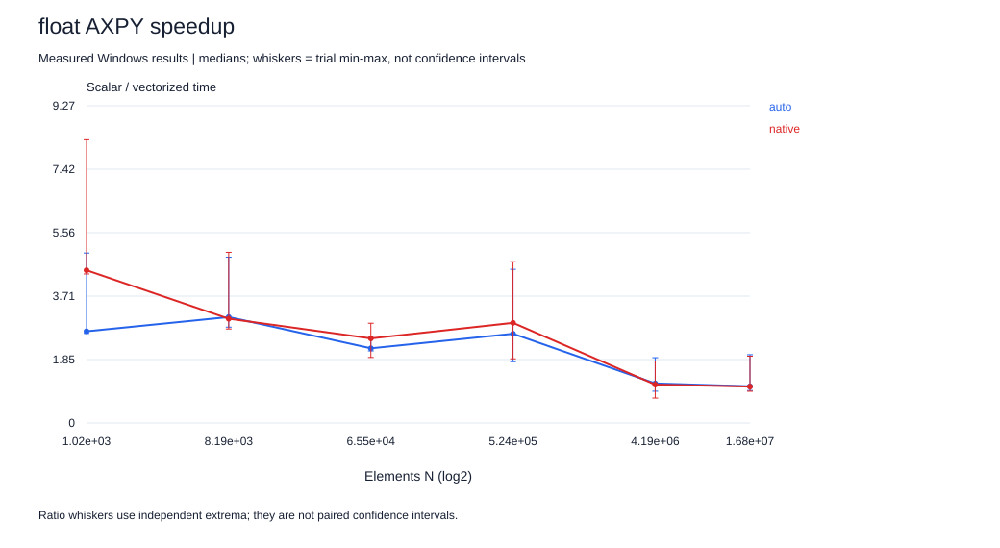
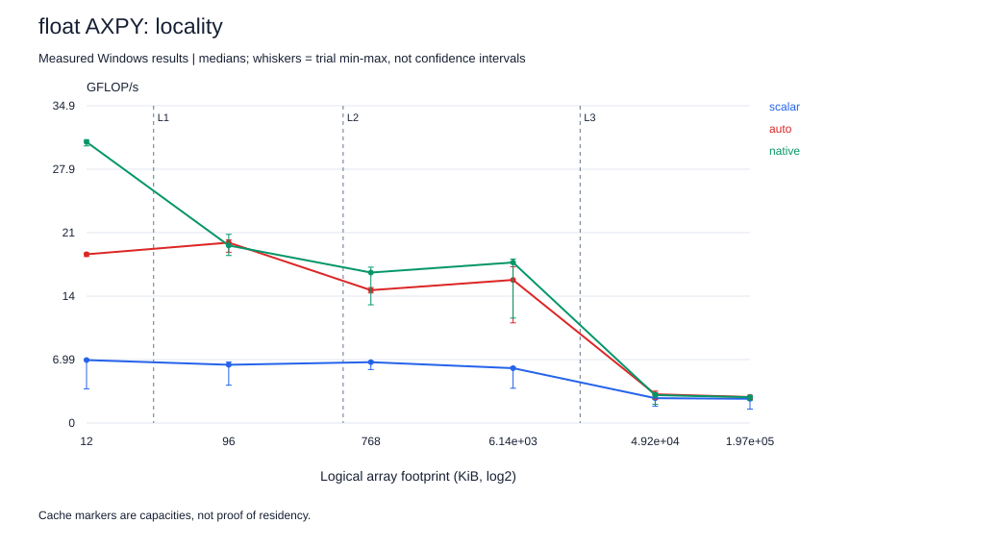
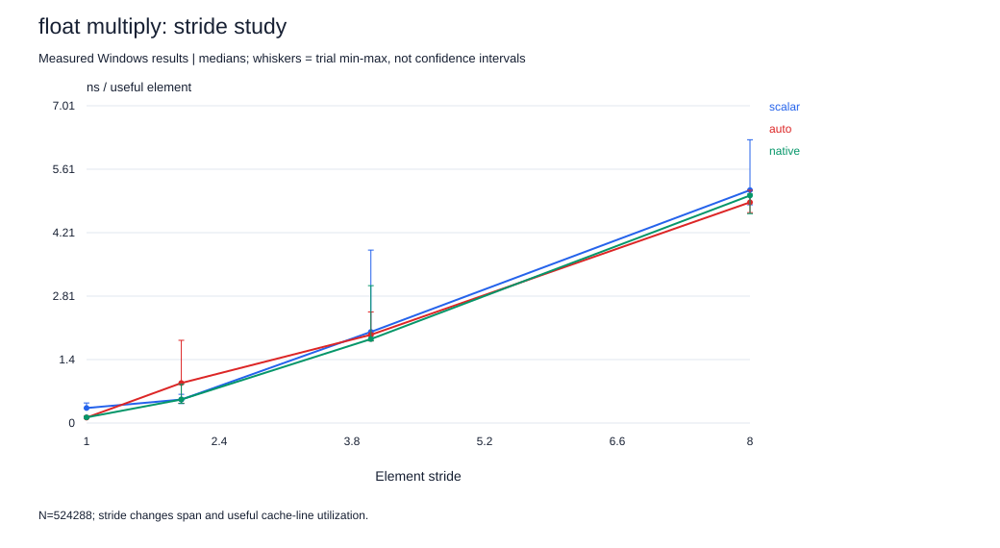
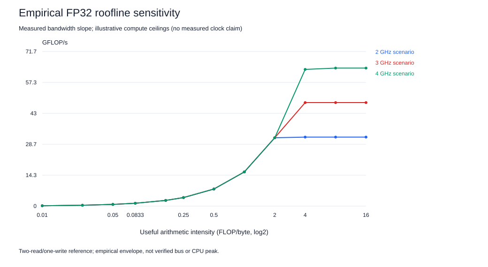
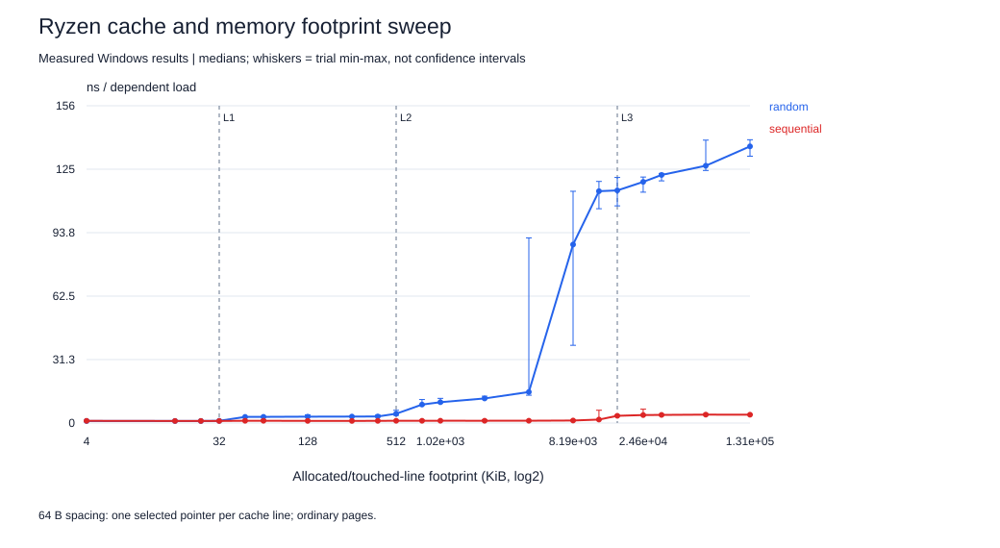
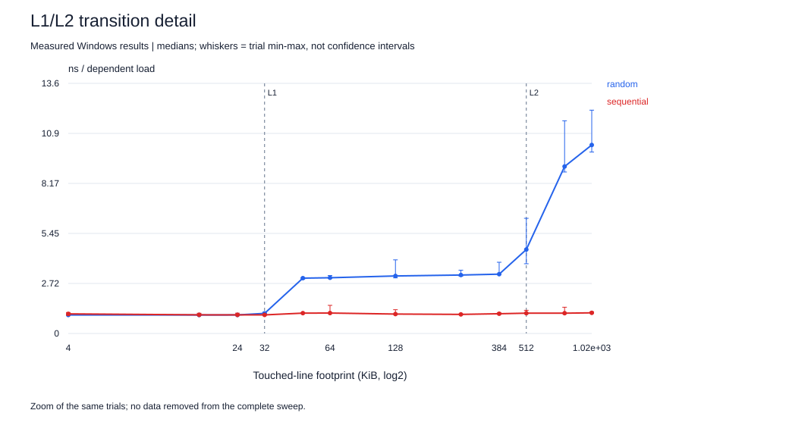
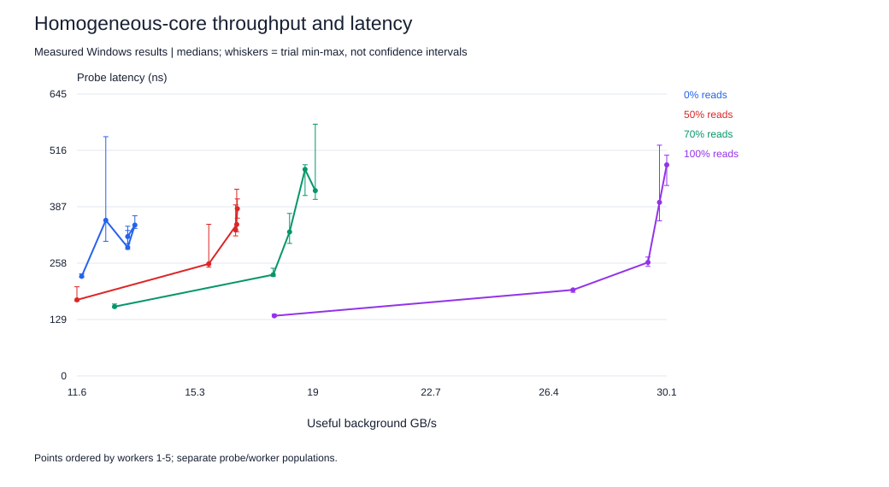
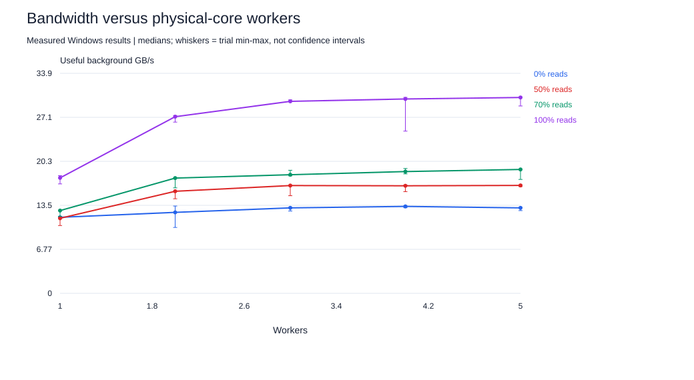
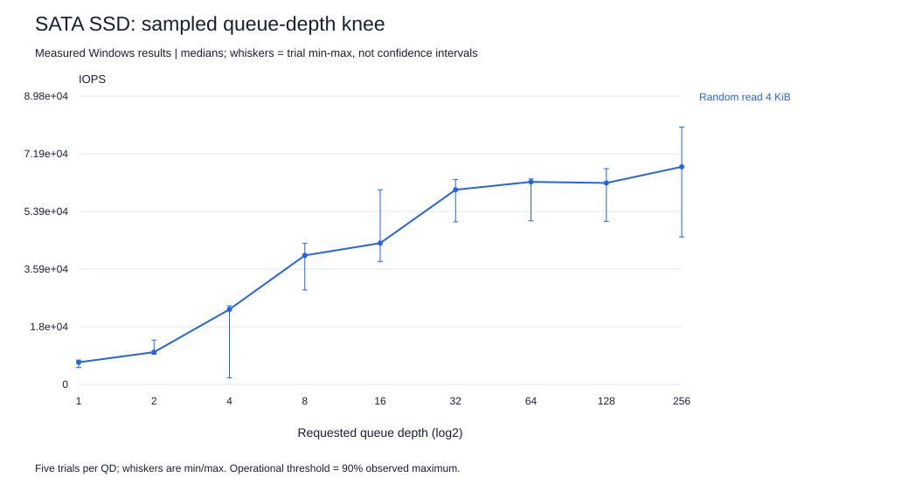
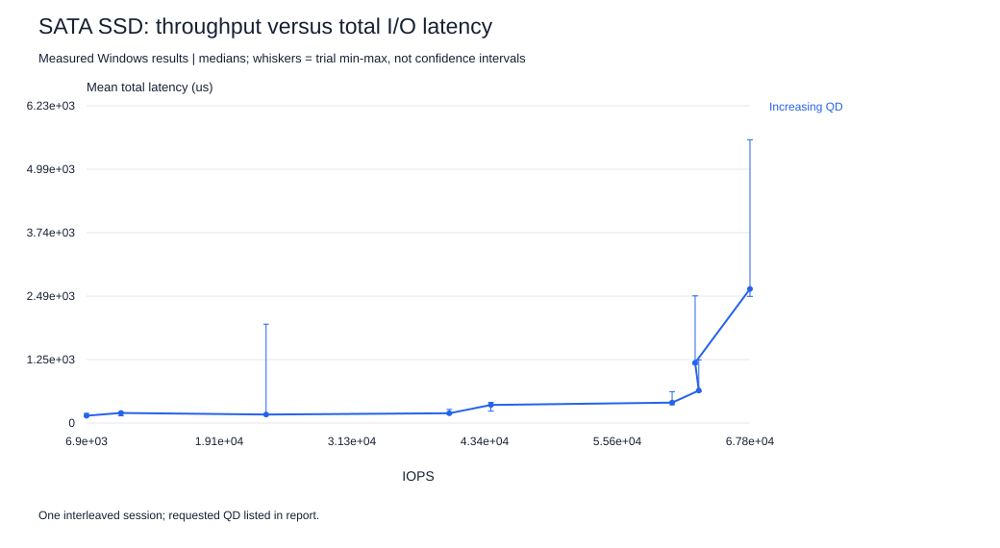

# October follow-up: SIMD, memory and SSD

Host: **AMD Ryzen 5 5500**, Windows-11-10.0.26200-SP0; gcc (GCC) 16.2.0. This is a separate machine/session from the retained Intel laptop studies. Do not pool their trials.

## Method and evidence status

Five repetitions per timed condition; fixed shuffled ordering within each suite. CPU tests use affinity to CPU0, warm-up, deterministic initialization and reference checks. Balanced policy remains active; frequency is not locked, SMT is enabled, and cores are not exclusively reserved. Normal desktop activity and assistant editing/tool calls continued. Min/max bars show observed variation, not confidence intervals. [Environment and topology](environment.json), [build commands](builds.json), [pre-experiment predictions](HYPOTHESES.md), and [source snapshots](sources/) are retained.

The SIMD suite uses 150 ms minimum windows, a 300 ms streaming reference, and 200 ms dependent-chain windows. The load follow-up uses one-second windows. The SSD follow-up uses five seconds after a two-second ramp. These are bounded observations rather than a steady-state certification.

## Project 1: SIMD

The three kernels, strict summation order and FMA-disabled build flags match the original study. AXPY is explicitly out of place (`z = 1.25*x + y`), so its footprint differs from in-place AXPY. Binary-fraction inputs allow checks against a scalar double reference. Each row retains its measured error and tolerance. Useful GB/s counts two reads plus one write (dot: two reads); it is not measured bus traffic.

| Type | Kernel | N | Native speedup | Native GFLOP/s median [min,max] |
|---|---|---|---|---|
| float | AXPY | 1024 | 4.465 | 30.944 [30.508, 31.188] |
| float | AXPY | 16777216 | 1.064 | 2.839 [2.520, 2.985] |
| float | Multiply | 1024 | 4.468 | 15.272 [9.895, 15.673] |
| float | Multiply | 16777216 | 1.062 | 1.476 [1.412, 1.485] |
| float | Ordered dot | 1024 | 0.986 | 2.547 [2.132, 2.618] |
| float | Ordered dot | 16777216 | 0.995 | 2.558 [2.298, 2.589] |
| double | AXPY | 1024 | 2.884 | 19.874 [17.994, 20.667] |
| double | AXPY | 16777216 | 1.035 | 1.348 [1.048, 1.450] |
| double | Multiply | 1024 | 2.840 | 9.794 [6.698, 10.602] |
| double | Multiply | 16777216 | 1.069 | 0.712 [0.634, 0.718] |
| double | Ordered dot | 1024 | 1.010 | 2.603 [2.585, 2.622] |
| double | Ordered dot | 16777216 | 0.864 | 1.974 [1.414, 2.255] |




### Alignment, tails and stride

Tables keep the four aligned/shifted and divisible/remainder cases separate. Small loops include timer/call overhead; differences of a few nanoseconds cannot be assigned wholly to vector prologue or tail code. A one-element offset misaligns the base by four/eight bytes; compiler evidence determines the actual vector width. Larger stride expands the span and reduces useful bytes per cache line.

| Type | N | Offset | Scalar ns/element | Auto ns/element | Native ns/element |
|---|---|---|---|---|---|
| float | 16 | 0 | 2.091 [2.070, 2.117] | 1.973 [1.951, 2.722] | 1.928 [1.907, 2.136] |
| float | 16 | 1 | 2.094 [2.018, 2.269] | 1.944 [1.936, 1.967] | 1.925 [1.904, 2.257] |
| float | 19 | 0 | 1.774 [1.741, 1.938] | 1.682 [1.661, 1.816] | 1.723 [1.645, 1.901] |
| float | 19 | 1 | 1.863 [1.760, 2.217] | 1.731 [1.667, 2.091] | 1.649 [1.641, 1.731] |
| float | 65536 | 0 | 0.299 [0.294, 0.340] | 0.137 [0.134, 0.140] | 0.121 [0.117, 0.154] |
| float | 65536 | 1 | 0.299 [0.296, 0.338] | 0.159 [0.154, 0.174] | 0.129 [0.126, 0.134] |
| float | 65539 | 0 | 0.295 [0.291, 0.311] | 0.130 [0.126, 0.139] | 0.114 [0.112, 0.115] |
| float | 65539 | 1 | 0.318 [0.299, 0.423] | 0.158 [0.156, 0.177] | 0.133 [0.132, 0.181] |
| double | 16 | 0 | 2.172 [2.098, 2.218] | 2.032 [1.956, 2.457] | 1.957 [1.930, 1.994] |
| double | 16 | 1 | 2.129 [2.088, 2.526] | 2.049 [1.982, 2.582] | 1.940 [1.923, 2.473] |
| double | 19 | 0 | 1.771 [1.742, 1.792] | 1.693 [1.691, 1.705] | 1.790 [1.656, 1.825] |
| double | 19 | 1 | 1.784 [1.769, 1.797] | 1.831 [1.690, 2.300] | 1.659 [1.651, 1.714] |
| double | 65536 | 0 | 0.386 [0.365, 0.575] | 0.300 [0.293, 0.302] | 0.238 [0.235, 0.340] |
| double | 65536 | 1 | 0.374 [0.365, 0.640] | 0.348 [0.338, 0.418] | 0.298 [0.281, 0.434] |
| double | 65539 | 0 | 0.368 [0.365, 0.423] | 0.298 [0.294, 0.362] | 0.238 [0.230, 0.242] |
| double | 65539 | 1 | 0.414 [0.366, 0.626] | 0.360 [0.352, 0.673] | 0.276 [0.269, 0.417] |

| Type | Stride | Scalar ns/element | Auto ns/element | Native ns/element |
|---|---|---|---|---|
| float | 1 | 0.332 [0.324, 0.443] | 0.120 [0.116, 0.152] | 0.125 [0.114, 0.138] |
| float | 2 | 0.519 [0.431, 0.635] | 0.884 [0.438, 1.829] | 0.520 [0.433, 0.856] |
| float | 4 | 2.015 [1.912, 3.823] | 1.951 [1.814, 2.456] | 1.856 [1.819, 3.037] |
| float | 8 | 5.149 [4.825, 6.263] | 4.880 [4.651, 5.144] | 5.030 [4.628, 5.063] |
| double | 1 | 0.459 [0.418, 0.630] | 0.297 [0.262, 0.357] | 0.334 [0.270, 0.414] |
| double | 2 | 1.955 [1.777, 2.120] | 2.209 [1.801, 4.529] | 1.913 [1.814, 2.083] |
| double | 4 | 5.484 [4.915, 6.377] | 5.215 [4.629, 5.667] | 5.250 [4.754, 5.512] |
| double | 8 | 15.067 [13.139, 18.239] | 12.979 [12.715, 14.082] | 13.719 [12.717, 16.515] |



float: shifting N=65536 by one element changes median native time/element by +7.1%; adding a three-element tail changes it by -5.4%. These are observed differences, not isolated instruction latencies.
double: shifting N=65536 by one element changes median native time/element by +24.9%; adding a three-element tail changes it by -0.2%. These are observed differences, not isolated instruction latencies.

At N=1024, native float32 AXPY throughput is 1.56x float64 throughput; at N=16777216 it is 2.11x. Float32 packs twice as many lanes and has twice the useful arithmetic intensity. Overhead and memory limits prevent a universal exact 2x rule.

### Vector evidence and negative case

Native compiler excerpts (source line, diagnostic):

```text
16:29: optimized: loop vectorized using 32 byte vectors and unroll factor 8
16:29: optimized: epilogue loop vectorized using 16 byte vectors and unroll factor 4
17:34: optimized: loop vectorized using 32 byte vectors and unroll factor 8
17:34: optimized: epilogue loop vectorized using 16 byte vectors and unroll factor 4
18:23: optimized: loop vectorized using 32 byte vectors and unroll factor 8
18:23: optimized: epilogue loop vectorized using 16 byte vectors and unroll factor 4
```

Selected instructions from this session's `kernel` function:

```text
140001500:	c5 f4 59 04 10       	vmulps (%rax,%rdx,1),%ymm1,%ymm0
140001505:	c4 c1 7c 58 04 10    	vaddps (%r8,%rdx,1),%ymm0,%ymm0
1400015b5:	c4 81 7a 58 44 10 08 	vaddss 0x8(%r8,%r10,1),%xmm0,%xmm0
140001616:	c5 f4 59 0c 10       	vmulps (%rax,%rdx,1),%ymm1,%ymm1
140001629:	c5 fa 58 c1          	vaddss %xmm1,%xmm0,%xmm0
14000162d:	c5 fa 58 c3          	vaddss %xmm3,%xmm0,%xmm0
```

The report shows 32-byte main vectors and narrower epilogues. That means eight float32 or four float64 lanes, not a promised 8x/4x speedup. FMA contraction remains off. The ordered reduction preserves serial addition dependencies even when products vectorize. Full disassembly is retained under `evidence/`; the original targeted [instruction explanation](../../project-1-simd/VECTOR-EVIDENCE.md) applies to the original compiler, not automatically to this new build.

The smallest measured native/scalar speedup is **0.864x** for double Ordered dot, N=16777216. It is retained even though the native target is intended as an optimization. Compare its variation and assembly before attributing the loss solely to vector width.

### Roofline with a traffic-matched reference

The independent streaming reference performs `z=x+y` using aligned AVX2 loads and ordinary cached stores, with the same two-read/one-write pattern and FP32 array sizes as AXPY. It validates every result before and after timing. It remains an empirical useful-bandwidth reference rather than a hardware upper limit. At the useful-byte level AXPY has 2/12=1/6 FLOP/B and multiply 1/12 FLOP/B; dot is 2/8=1/4 but has a different traffic mix.

| N | Reference GB/s [min,max] | AXPY reference GFLOP/s | Observed AXPY GFLOP/s | Observed / reference |
|---|---|---|---|---|
| 4194304 | 18.248 [17.965, 18.343] | 3.041 | 3.072 | 1.010 |
| 16777216 | 15.848 [15.105, 16.775] | 2.641 | 2.839 | 1.075 |

For a physical-traffic model with write allocation, 16 rather than 12 bytes/element gives 1/8 FLOP/B for AXPY. A measured **useful** GB/s number cannot be multiplied by that physical intensity without also changing its byte convention. Doing so was a limitation of the earlier read-only proxy. These new tables use one consistent useful-byte convention; without controller counters, physical traffic is still unmeasured.

A compute sensitivity line can be estimated as vector operations/cycle × lanes × FLOPs/operation × GHz. For example, an explicitly assumed two 256-bit vector operations/cycle gives 16 FP32 FLOPs/cycle for separate add/multiply, or 32 for two FMAs. At assumed 2/3/4 GHz the separate-operation scenarios are 32/48/64 GFLOP/s. These are scenario ceilings, not measured clock rates or a claim that each kernel can saturate every execution unit. The actual compiled code disables FMA. Low intensity and falling SIMD gains support a data-movement explanation; a reference exceedance must remain visible.



## Project 2: memory hierarchy

The dependent random chain serializes demand loads, and the predictable chain is a controlled misleading-benchmark example. Every permutation is checked as one cycle, with final index validation after timing. Capacity transitions are expectations based on CPUID, not assigned from convenient latency jumps.




| Footprint KiB | Random ns/load [min,max] | Sequential ns/load [min,max] |
|---|---|---|
| 4 | 1.006 [1.001, 1.016] | 1.067 [0.994, 1.141] |
| 16 | 1.006 [0.998, 1.017] | 1.014 [0.999, 1.102] |
| 24 | 1.009 [1.001, 1.022] | 1.011 [1.005, 1.106] |
| 32 | 1.094 [1.084, 1.153] | 1.011 [0.995, 1.059] |
| 48 | 3.013 [2.960, 3.026] | 1.108 [1.104, 1.124] |
| 64 | 3.034 [3.004, 3.155] | 1.112 [1.096, 1.532] |
| 128 | 3.131 [3.027, 4.009] | 1.057 [1.042, 1.294] |
| 256 | 3.182 [3.121, 3.445] | 1.039 [1.031, 1.060] |
| 384 | 3.229 [3.223, 3.878] | 1.075 [1.044, 1.122] |
| 512 | 4.571 [3.797, 6.270] | 1.105 [1.088, 1.262] |
| 768 | 9.091 [8.791, 11.581] | 1.105 [1.102, 1.429] |
| 1024 | 10.263 [9.878, 12.158] | 1.124 [1.099, 1.181] |
| 2048 | 12.116 [11.898, 13.220] | 1.120 [1.106, 1.564] |
| 4096 | 15.289 [13.703, 91.242] | 1.135 [1.091, 1.164] |
| 8192 | 87.976 [38.300, 114.212] | 1.235 [1.141, 1.645] |
| 12288 | 114.260 [105.609, 119.072] | 1.702 [1.583, 6.296] |
| 16384 | 114.632 [107.024, 121.024] | 3.556 [3.524, 3.947] |
| 24576 | 118.852 [113.774, 121.235] | 3.922 [3.798, 6.825] |
| 32768 | 122.263 [119.348, 123.013] | 3.996 [3.943, 4.124] |
| 65536 | 126.799 [124.466, 139.422] | 4.129 [3.980, 4.596] |
| 131072 | 136.346 [131.504, 139.611] | 4.099 [4.048, 4.156] |

This denser sweep reduces the risk of skipping a transition. Random-chain latency includes translation and cache effects. Sequential latency can be far smaller because predictability enables prefetching; it is not intrinsic random DRAM latency. Hardware-counter correlation is still required before separating cache and TLB causes. The original [pattern/granularity and R/W matrix](../../project-2-memory/docs/PILOT-README.md) remains a distinct Intel session.

| Candidate dominant regime | Footprint | Observed random ns/load [min,max] |
|---|---|---|
| L1 | 16 KiB | 1.006 [0.998, 1.017] |
| L2 | 256 KiB | 3.182 [3.121, 3.445] |
| LLC | 2048 KiB | 12.116 [11.898, 13.220] |
| DRAM + translation | 131072 KiB | 136.346 [131.504, 139.611] |

These are low-load candidates, not pure component latencies. The rise around 32 KiB/512 KiB is consistent with reported L1D/L2 capacities. The early, highly variable rise around 4-8 MiB cannot simply be labeled the 16 MiB LLC boundary: competing occupancy, address translation, scheduling, physical mapping and boost state are plausible contributors. The 4 MiB maximum is retained, not discarded as an inconvenient outlier.

### Contention and a sampled knee

The probe uses a 64 MiB random chain on CPU0. Up to five AVX2 traffic workers use 128 MiB each on CPUs 2/4/6/8/10, verified as distinct physical cores. SMT stays enabled, with no deliberate sibling workload. Percentages describe 32-byte read/store operations; cache write allocation means physical bus traffic and ratios differ. All buffer initialization precedes timing. Stop checks occur at 128 KiB chunks.

Unloaded probe: **121.056 [116.233, 129.831] ns/load**. Maximum observed start lag: 3145.1 us; maximum end overhang: 22506.4 us. Background throughput uses the probe-start to final-worker-end interval, including those edge effects.




| Read % | Workers | GB/s [min,max] | Probe ns [min,max] |
|---|---|---|---|
| 0 | 1 | 11.704 [11.602, 11.761] | 227.861 [225.927, 233.468] |
| 0 | 2 | 12.465 [10.147, 13.438] | 356.112 [308.087, 547.470] |
| 0 | 3 | 13.156 [12.675, 13.241] | 294.089 [289.705, 332.894] |
| 0 | 4 | 13.381 [13.173, 13.458] | 345.152 [337.567, 366.467] |
| 0 | 5 | 13.156 [12.737, 13.250] | 318.894 [302.654, 342.539] |
| 50 | 1 | 11.555 [10.438, 11.635] | 174.057 [171.414, 204.047] |
| 50 | 2 | 15.711 [14.556, 15.758] | 256.445 [248.832, 347.007] |
| 50 | 3 | 16.592 [15.031, 16.660] | 346.551 [330.002, 427.272] |
| 50 | 4 | 16.558 [15.652, 16.660] | 334.061 [320.430, 391.369] |
| 50 | 5 | 16.612 [16.436, 16.702] | 382.634 [360.988, 405.040] |
| 70 | 1 | 12.741 [11.859, 12.778] | 158.568 [156.730, 164.595] |
| 70 | 2 | 17.743 [16.241, 17.777] | 231.640 [227.989, 246.392] |
| 70 | 3 | 18.259 [18.090, 18.944] | 329.471 [303.215, 371.841] |
| 70 | 4 | 18.747 [18.390, 19.220] | 472.565 [412.876, 483.238] |
| 70 | 5 | 19.070 [17.534, 19.140] | 423.989 [404.049, 576.020] |
| 100 | 1 | 17.776 [16.849, 18.119] | 137.588 [135.451, 141.069] |
| 100 | 2 | 27.194 [26.358, 27.373] | 196.873 [191.366, 197.569] |
| 100 | 3 | 29.558 [29.535, 29.782] | 259.819 [250.693, 272.116] |
| 100 | 4 | 29.920 [24.973, 30.167] | 397.186 [354.954, 528.018] |
| 100 | 5 | 30.149 [28.844, 30.239] | 482.986 [435.745, 505.096] |

- 0% reads: first 90%-of-observed-maximum point is 2 workers; maximum median 13.38 GB/s. The last worker changes throughput by -1.7%. A threshold at the last sampled point does not establish saturation.
- 50% reads: first 90%-of-observed-maximum point is 2 workers; maximum median 16.61 GB/s. The last worker changes throughput by +0.3%. A threshold at the last sampled point does not establish saturation.
- 70% reads: first 90%-of-observed-maximum point is 2 workers; maximum median 19.07 GB/s. The last worker changes throughput by +1.7%. A threshold at the last sampled point does not establish saturation.
- 100% reads: first 90%-of-observed-maximum point is 2 workers; maximum median 30.15 GB/s. The last worker changes throughput by +0.8%. A threshold at the last sampled point does not establish saturation.

### Little's Law: how many cache lines are in flight?

For the 100%-read mix, L = lambda x W with lambda in 64-byte lines per second. Using the unloaded probe latency (121 ns) as W gives a **lower bound** on lines in flight, because no request completes faster than an idle one. Using the loaded probe latency gives an **estimate**, assuming worker misses wait about as long as the probe's.

| Workers | GB/s | Lines in flight, lower bound | Probe latency ns | Lines in flight, estimate | Estimate per worker |
|---|---|---|---|---|---|
| 1 | 17.8 | 34 | 138 | 38 | 38 |
| 2 | 27.2 | 51 | 197 | 84 | 42 |
| 3 | 29.6 | 56 | 260 | 120 | 40 |
| 4 | 29.9 | 57 | 397 | 186 | 46 |
| 5 | 30.1 | 57 | 483 | 228 | 46 |

One core streaming alone keeps at least 34 lines in flight. A single thread's demand loads cannot do that by themselves; the hardware prefetchers supply most of the concurrency. The per-worker estimate stays nearly constant (38-46 lines): each core sustains about the same number of outstanding misses, its own miss-tracking capacity, whatever the other cores do. Past the knee, adding workers multiplies the estimated occupancy (about 228 lines with 5 workers) while throughput barely moves, so by Little's Law the extra requests can only turn into extra waiting time. That is the queueing knee: once the memory controller and DRAM banks are busy, more concurrency buys latency, not bandwidth.

Little's Law applies to one request population: L=lambda*W. The background streamers and dependent probe are different populations, so their values cannot be combined into an exact in-flight request count. Their joint curve shows contention. AMAT requires actual conditional miss rates and incremental penalties; capacity labels or timing differences are not substitutes for those rates.

## Project 3: SSD queueing follow-up

The new host uses an **ADATA SU650 SATA SSD**, NTFS, and a new 2 GiB disposable file. It is not the old laptop SSD. fio uses `windowsaio`, direct I/O, one job, aligned 4 KiB random reads, and incompressible buffers. A complete file prefill and separate CRC32C verification precede the interleaved study. The exact test file is removed only after successful completion. [Configs](ssd/configs/), [raw fio JSON](ssd/raw/), and [collection settings](ssd/environment.json) are retained.

The original Intel/laptop block-size, read/write-mix, range and buffering studies remain valid for their own device and are linked in the [original SSD report](../../project-3-ssd/README.md). This follow-up addresses the mixed-session QD curve; it does not merge new and old drive results.

Within this one session, the maximum median is **67,792 IOPS**; the first QD reaching 90% is **QD64**. This is an operational sampled threshold, not a device specification.




| QD | IOPS [min,max] | Mean us [min,max] | Median L=IOPS*mean seconds |
|---|---|---|---|
| 1 | 6896.021 [5254.549, 7559.488] | 143.617 [130.930, 188.898] | 0.990 |
| 2 | 10057.189 [9392.322, 13823.235] | 197.422 [141.000, 211.164] | 1.985 |
| 4 | 23377.724 [2055.759, 24492.302] | 166.664 [156.650, 1941.990] | 3.896 |
| 8 | 40193.361 [29427.714, 43919.816] | 191.893 [174.530, 267.389] | 7.713 |
| 16 | 44013.597 [38293.624, 60643.871] | 355.074 [233.427, 405.887] | 15.543 |
| 32 | 60647.870 [50645.071, 63806.039] | 400.916 [357.880, 617.395] | 24.315 |
| 64 | 63095.781 [50959.216, 64021.596] | 638.480 [613.311, 1240.702] | 40.877 |
| 128 | 62758.048 [50792.524, 67218.756] | 1184.793 [1152.632, 2498.147] | 79.590 |
| 256 | 67792.242 [45936.276, 80190.248] | 2634.539 [2487.246, 5565.603] | 211.264 |

Throughput and mean total latency come from the same run and population. L is computed per run before aggregation. It can differ from configured QD because fio sometimes has fewer requests outstanding; achieved-depth histograms remain in the raw JSON. A depth bucket of >=64 cannot distinguish QD64 from QD256 by itself.

### QD1 baselines and tails

| Pattern | KiB | IOPS | MB/s | Mean us | p50 us | p95 us | p99 us | p99.9 us |
|---|---|---|---|---|---|---|---|---|
| randread | 4 | 5896.821 | 24.153 | 168.027 | 138.240 | 209.920 | 259.072 | 509.952 |
| randwrite | 4 | 15455.709 | 63.307 | 63.009 | 58.112 | 82.432 | 109.056 | 248.832 |
| read | 128 | 3210.558 | 420.814 | 310.069 | 296.960 | 362.496 | 585.728 | 806.912 |
| write | 128 | 2532.693 | 331.965 | 387.884 | 382.976 | 423.936 | 536.576 | 856.064 |

| QD | p50 us | p95 us | p99 us | p99.9 us |
|---|---|---|---|---|
| 8 | 175.104 | 276.480 | 321.536 | 448.512 |
| 64 | 634.880 | 1011.712 | 1171.456 | 1613.824 |

Percentiles above are medians of per-run percentiles, not percentiles of a pooled distribution. Five-second trials provide limited evidence about rare stalls. QD1 is a low-queue baseline including OS/engine/device latency, not raw NAND latency or a guarantee of no background queue. SATA host/controller limits and flash parallelism can constrain throughput. No temperature trend, SLC-cache exhaustion, durability or steady-state claim is inferred from these tests.

## Companion reports for this session

- [Measured roofline](ROOFLINE.md): kernel points on measured DRAM and in-cache roofs with a compute roof at the measured clock.
- [Hardware counters](COUNTERS.md): measured core cycles per element, IPC, L1/L2 DTLB misses and demand DRAM fills per load, an AMAT-style fit and a page-walk cost estimate. Invariant TSC ticks are shown beside core cycles, never relabeled as them.
- [SIMD extension](SIMD-EXTENSION.md): int32 versus float32/float64, a three-point stencil, and a gather-indexed loop (negative case) with a forced hardware-gather control.
- [SSD extension](SSD-EXTENSION.md): block-size sweep, read/write mix, data pattern, buffered versus direct I/O (cold and warm cache), and a 40 GiB sustained write showing the SLC-cache sawtooth.
- [Optional GPU comparison](GPU.md): kernel-only versus end-to-end AXPY on a GTX 1660 Ti.

- [Large pages](LARGE-PAGES.md): 4 KiB versus 2 MiB pages for the same chains (the main timing session had no lock-pages privilege; it was granted afterwards), plus the same study on a busy machine as a benchmark pitfall.

## Student review

The original [rubric audit](../../docs/archive/RUBRIC.md) and [submission gates](../../docs/archive/SUBMISSION-GATES.md) distinguish conditional features from required evidence. The student must independently review, test and understand the work before submission. AI assistance is described in [the disclosure](../../docs/AI-USE.md); no independent student checks are inferred from AI-executed runs.
