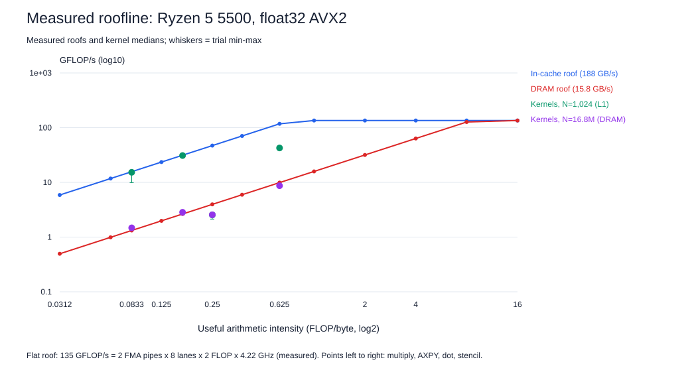

# Measured roofline (float32, native AVX2)

Everything on this plot is measured on the Ryzen host except the flat compute roof, which is the standard peak estimate evaluated at the **measured** clock: 2 FMA pipes x 8 float lanes x 2 FLOPs x 4.22 GHz (median core clock from the TotalCycles counter during the benchmark runs) = **135 GFLOP/s**. The DRAM roof is the traffic-matched two-read/one-write reference at N=16,777,216 (**15.8 GB/s** useful). The in-cache roof is the highest useful-byte rate reached by any validated native run at N=1,024 (188 GB/s), so it is an achieved bound, not a hardware specification. Intensity counts useful bytes, the same convention as both bandwidth roofs; write-allocate traffic would lower the physical intensity of store kernels by about a quarter.

| Kernel | FLOP/byte | N=1,024 GFLOP/s | % of in-cache roof | N=16.8M GFLOP/s | % of DRAM roof |
|---|---:|---:|---:|---:|---:|
| multiply | 0.083 | 15.27 | 97% | 1.48 | 112% |
| AXPY | 0.167 | 30.94 | 99% | 2.84 | 107% |
| ordered dot | 0.250 | 2.55 | 5% | 2.56 | 65% |
| stencil | 0.625 | 42.57 | 36% | 8.68 | 88% |

**Reading it.** The ridge point is at 8.5 FLOP/byte against DRAM. Every kernel here is between 1/12 and 5/8 FLOP/byte, at least 14x to the left of the ridge, so from DRAM all of them are memory-bound regardless of vector width. That is why the multiply, AXPY and stencil DRAM points sit on or near the sloped roof and why native/scalar speedups compress toward 1x at large N.

In cache, AXPY defines the empirical roof, so its 99% is circular; multiply independently reaches 97% of it. The stencil reaches only 36%, although it has the highest useful intensity: it issues three overlapping loads of x per output vector, and useful-byte intensity counts x only once. In L1 the limit is load issue, not bytes from memory.

**The ordered dot product is latency-bound, not memory-bound.** It delivers 2.55 GFLOP/s with N=1,024 in L1 and 2.56 GFLOP/s from DRAM: the same rate at a 16,000x larger working set. A memory-bound kernel would slow down by roughly the 12x gap between the two roofs. Each addition must wait for the previous one because the source fixes the summation order, so the rate is set by the floating-point add latency, a ceiling the roofline model does not draw. Quantitatively: 2.55 GFLOP/s is 1.27 G additions/s, or 3.3 cycles per addition at 4.22 GHz, matching Zen 3's documented 3-cycle floating-point add latency. Neither more bandwidth nor wider vectors can help this kernel; only reassociating the sum (several partial accumulators) can.

Some DRAM points can exceed the reference by a few percent (the reference is an achieved bound, and kernels with fewer arrays get slightly better prefetch behavior); the table keeps the measured ratio rather than clipping it.
