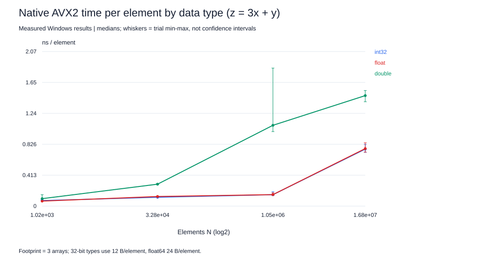
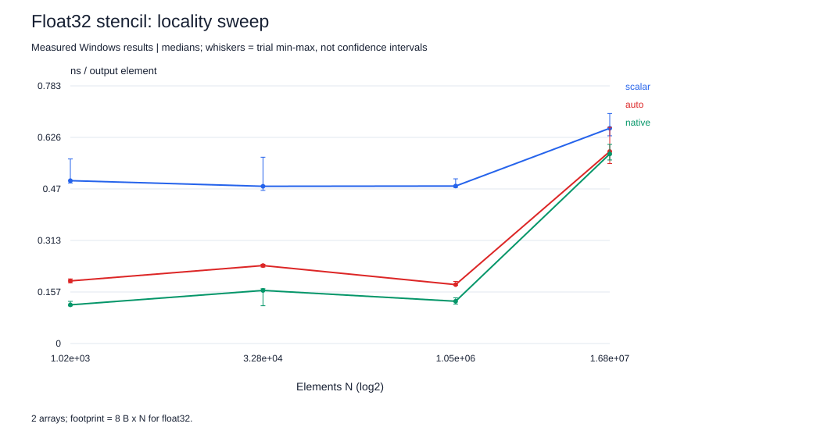
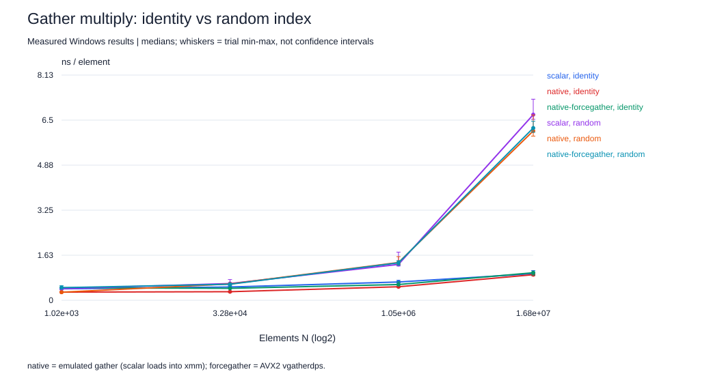

# SIMD extension: data types, stencil and gather

Same host and compiler as the main Ryzen session (gcc.EXE (GCC) 16.2.0); new source [`simd_ext.c`](simd-extension/simd_ext.c), 500 validated runs, 5 trials per condition, interleaved in a fixed shuffled order, pinned to CPU0, 0.2 s timing windows. [Predictions](simd-extension/HYPOTHESES.md) were written before collection. Every run is checked against a double-precision reference first (int32: exact). Builds: `scalar` = `-O3 -fno-tree-vectorize`, `auto` = `-O3` (SSE2 baseline), `native` = `-O3 -march=native` (AVX2), all with `-ffp-contract=off`. Compiler reports and per-kernel instruction counts are in [`simd-extension/evidence/`](simd-extension/evidence/).

## Data type: int32 vs float32 vs float64

Kernel `z = 3x + y` with identical code for each type. Values are ns per element, median [min,max].

| N | Footprint KiB (32-bit) | int32 scalar | int32 native | float32 scalar | float32 native | float64 scalar | float64 native | Native speedup i32 / f32 / f64 |
|---:|---:|---|---|---|---|---|---|---|
| 1,024 | 12 | 0.433 [0.431, 0.455] | 0.074 [0.071, 0.087] | 0.304 [0.297, 0.314] | 0.067 [0.066, 0.068] | 0.308 [0.300, 0.351] | 0.100 [0.097, 0.152] | 5.87x / 4.53x / 3.10x |
| 32,768 | 384 | 0.427 [0.413, 0.435] | 0.119 [0.118, 0.126] | 0.380 [0.375, 0.389] | 0.128 [0.126, 0.132] | 0.498 [0.447, 0.510] | 0.293 [0.288, 0.303] | 3.60x / 2.96x / 1.70x |
| 1,048,576 | 12,288 | 0.461 [0.445, 0.501] | 0.153 [0.141, 0.192] | 0.391 [0.376, 0.476] | 0.153 [0.149, 0.178] | 1.126 [1.076, 1.195] | 1.080 [0.996, 1.844] | 3.02x / 2.55x / 1.04x |
| 16,777,216 | 196,608 | 0.895 [0.752, 1.024] | 0.762 [0.720, 0.826] | 0.799 [0.752, 0.810] | 0.769 [0.721, 0.846] | 1.561 [1.498, 1.714] | 1.477 [1.395, 1.545] | 1.17x / 1.04x / 1.06x |

**Interpretation.** In L1 (N=1,024) int32 and float32 cost 0.074 and 0.067 ns/element: both pack 8 lanes per 256-bit register, so lane count, not integer versus floating point, sets the rate. Float64 has 4 lanes and costs 0.100 ns (1.49x float32). From DRAM (N=16,777,216) the ratio float64/float32 is 1.92x, close to the 2x byte ratio, because both are moving data at the same bandwidth; int32/float32 is 0.99x. Vector width per type matters in cache; bytes per element matter from memory.

## 1D three-point stencil

`z[i] = 0.25x[i-1] + 0.5x[i] + 0.25x[i+1]`: 5 FLOPs per output (3 multiplies, 2 adds) and 8 useful bytes (one read of x, one write of z for float32), so the useful arithmetic intensity is 5/8 = 0.625 FLOP/B for float32, compared with 1/6 for AXPY.

Vector evidence (stencil kernel, native build): 19 ymm / 58 xmm / 0 gather instructions; scalar build: 0 ymm / 64 xmm / 0 gather.

| Type | N | Scalar ns/elem | Auto ns/elem | Native ns/elem | Native speedup | Native GFLOP/s |
|---|---:|---|---|---|---:|---:|
| float | 1,024 | 0.495 [0.488, 0.561] | 0.190 [0.185, 0.196] | 0.117 [0.114, 0.128] | 4.21x | 42.57 |
| float | 32,768 | 0.478 [0.465, 0.566] | 0.237 [0.232, 0.241] | 0.161 [0.115, 0.166] | 2.96x | 31.02 |
| float | 1,048,576 | 0.478 [0.474, 0.500] | 0.179 [0.177, 0.188] | 0.128 [0.120, 0.139] | 3.73x | 38.95 |
| float | 16,777,216 | 0.654 [0.631, 0.699] | 0.583 [0.546, 0.657] | 0.576 [0.557, 0.605] | 1.14x | 8.68 |
| double | 1,024 | 0.500 [0.493, 1.149] | 0.317 [0.308, 0.353] | 0.197 [0.189, 0.204] | 2.54x | 25.37 |
| double | 32,768 | 0.507 [0.496, 0.556] | 0.415 [0.398, 0.490] | 0.337 [0.326, 0.409] | 1.50x | 14.82 |
| double | 1,048,576 | 0.850 [0.819, 0.952] | 0.844 [0.664, 1.547] | 0.671 [0.605, 0.833] | 1.27x | 7.46 |
| double | 16,777,216 | 1.174 [1.162, 1.271] | 1.200 [1.113, 1.271] | 1.132 [1.085, 1.298] | 1.04x | 4.42 |

**Interpretation.** In cache the stencil gains 4.21x from AVX2 versus 4.53x for `3x + y`; from DRAM 1.14x versus 1.04x. The stencil reuses each loaded x value in three outputs (neighbors overlap in registers and L1), so it does more arithmetic per byte fetched from memory and keeps more SIMD benefit when the arrays no longer fit in cache. It still compresses as the working set grows, which is the roofline argument: higher intensity moves the kernel right on the roofline, toward but not into the compute-bound region.

## Gather-indexed multiply (negative case)

`z[i] = x[idx[i]] * y[i]` with `idx` either the identity permutation (perfect locality, but the compiler cannot know that) or a random permutation. Float32 only.

| Build | Flags beyond -O3 | Gather kernel: ymm / xmm / hardware gather instructions |
|---|---|---|
| scalar | -fno-tree-vectorize | 0 ymm / 3 xmm / 0 gather |
| auto | (SSE2 baseline) | 0 ymm / 26 xmm / 0 gather |
| native | -march=native | 0 ymm / 28 xmm / 0 gather |
| native-nogather | -march=native, gathers disabled by -mtune-ctrl | 0 ymm / 28 xmm / 0 gather |
| native-forcegather | -march=native, gathers enabled by -mtune-ctrl | 14 ymm / 19 xmm / 2 gather |

| Index | N | scalar | auto | native | native-nogather | native-forcegather | Best vector / scalar |
|---|---:|---|---|---|---|---|---:|
| identity | 1,024 | 0.413 [0.393, 0.462] | 0.304 [0.296, 0.310] | 0.295 [0.287, 0.308] | 0.301 [0.293, 0.308] | 0.451 [0.447, 0.456] | 1.40x |
| identity | 32,768 | 0.479 [0.471, 0.490] | 0.311 [0.300, 0.332] | 0.309 [0.293, 0.318] | 0.309 [0.289, 0.340] | 0.432 [0.430, 0.447] | 1.55x |
| identity | 1,048,576 | 0.660 [0.627, 0.720] | 0.503 [0.468, 0.555] | 0.488 [0.466, 0.499] | 0.480 [0.460, 0.552] | 0.568 [0.558, 0.668] | 1.37x |
| identity | 16,777,216 | 0.959 [0.894, 1.072] | 0.926 [0.904, 0.953] | 0.924 [0.891, 0.929] | 0.917 [0.877, 0.964] | 0.995 [0.910, 1.017] | 1.05x |
| random | 1,024 | 0.417 [0.404, 0.425] | 0.298 [0.296, 0.336] | 0.292 [0.292, 0.296] | 0.290 [0.290, 0.294] | 0.456 [0.449, 0.525] | 1.44x |
| random | 32,768 | 0.604 [0.588, 0.748] | 0.587 [0.584, 0.615] | 0.590 [0.567, 0.602] | 0.577 [0.566, 0.597] | 0.578 [0.536, 0.592] | 1.05x |
| random | 1,048,576 | 1.294 [1.235, 1.737] | 1.430 [1.380, 2.082] | 1.363 [1.283, 1.575] | 1.377 [1.296, 1.706] | 1.351 [1.267, 1.431] | 0.96x |
| random | 16,777,216 | 6.697 [6.528, 7.255] | 6.317 [5.972, 6.432] | 6.110 [5.923, 6.686] | 6.025 [5.998, 6.502] | 6.214 [6.062, 6.458] | 1.11x |

**What the compiler actually did.** The plain AVX2 build contains **no hardware gather instruction**: GCC 16's Zen 3 tuning avoids `vgatherdps` and emits an *emulated gather*, scalar loads packed into 128-bit `xmm` registers followed by a vector multiply. The SSE2 `auto` build does the same, which is why `auto`, `native` and `native-nogather` perform identically. Only `native-forcegather` uses real 256-bit `vgatherdps`. A first compile check during this work wrongly reported gathers in the native build because it counted jump-target labels such as `<gather+0x40>` as instructions. The pre-collection prediction repeats that mistake and is left unedited. Checking mnemonics in the disassembly caught it: a flag or a quick text search is not proof of the instructions that run.

**Interpretation.** Even with a perfectly local identity index in L1, the emulated gather gains only 1.40x over scalar, against 4.53x for the contiguous `3x + y` kernel at the same size: each lane is still a separate load, so vectorizing saves arithmetic instructions but not memory accesses. The hardware gather is slower than the emulated one (0.451 versus 0.295 ns/element), and even slower than plain scalar code (0.413), confirming that GCC's tuning choice is right for Zen 3, where vgatherdps is split into many micro-ops. With a random index and N=16,777,216 every build takes 6.0-6.7 ns/element, 7.0x the identity-index time: each element is a random cache-line, and often page, access into a 64 MiB array. The core waits on memory latency and memory-level parallelism, so no form of SIMD helps. In L1 (N=1,024) random and identity indices cost the same; access order starts to matter once x leaves the L1/L2 caches.

## Limits

- 0.2 s windows and five trials; min/max ranges are not confidence intervals.
- Footprints are logical bytes; physical traffic (write-allocate, prefetch) was not counted in this extension.
- Gather results depend on the microarchitecture: Zen 3 implements AVX2 gathers as multiple micro-ops; other cores (for example recent Intel) have faster gathers.
