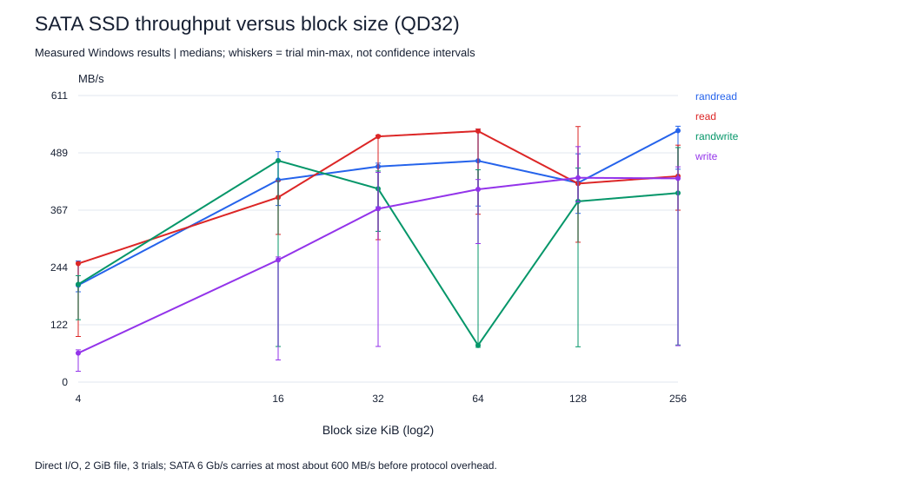
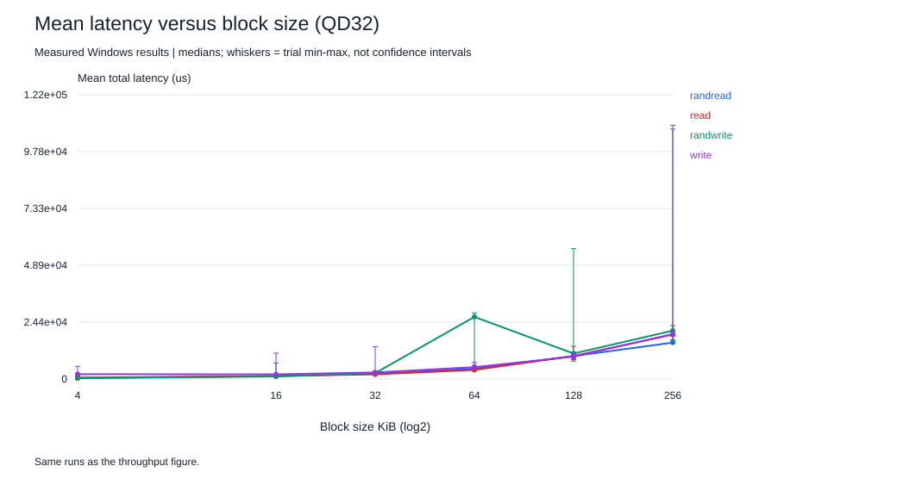
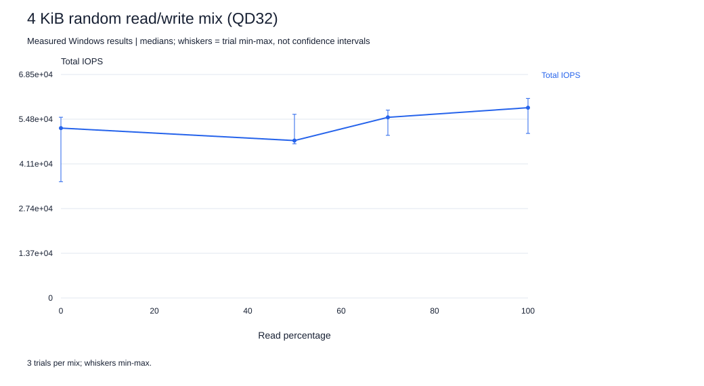
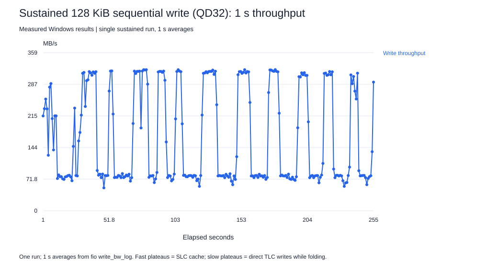
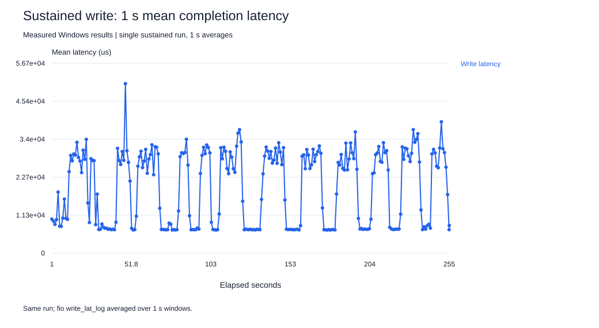
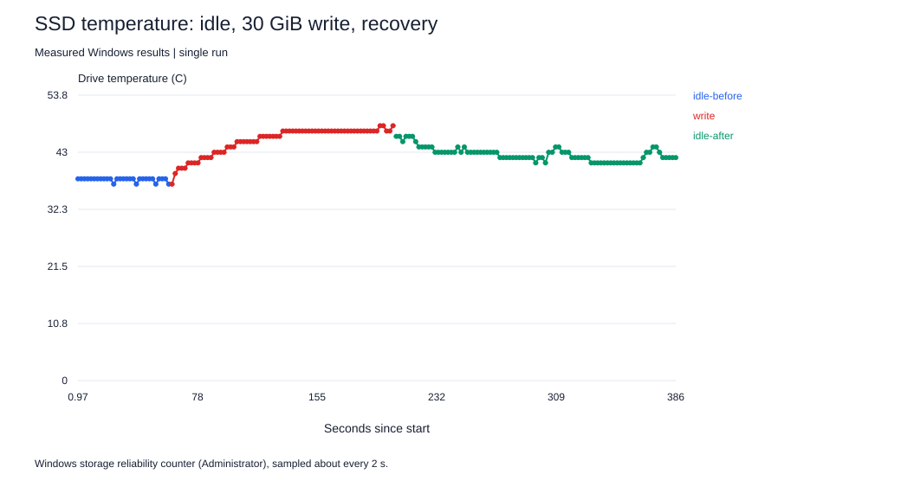
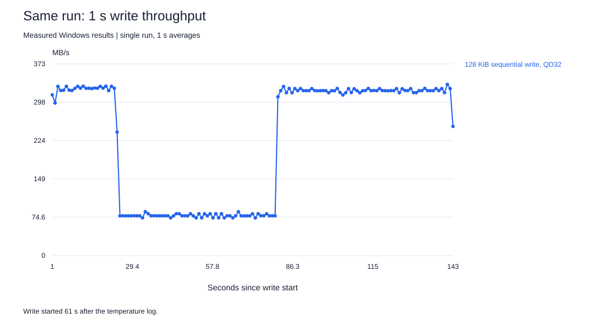

# SSD extension: block size, mix, data pattern, buffering and device state

Same host and drive as the Ryzen QD study (**ADATA SU650**, SATA 6 Gb/s, NTFS system volume, 16 GiB RAM), fio 3.43, `windowsaio`, one job. Disposable files only: a 2 GiB prefilled and CRC32C-verified matrix file and a 40 GiB sustained-write file, both deleted after success. Matrix runs: 5 s after a 2 s ramp, 3 trials per condition, all 99 runs interleaved in one shuffled order. [Predictions](ssd-extension/HYPOTHESES.md) were written before collection; [configs](ssd-extension/configs/), [raw JSON](ssd-extension/raw/), [1 s logs](ssd-extension/logs/).

Fixed unless stated: direct I/O, QD32 (the SATA NCQ limit, so every request can be outstanding in the drive), incompressible buffers, 2 GiB LBA range. Throughput and latency in each row come from the same runs.

## Block-size sweep (QD32)

| Pattern | Block KiB | IOPS [min,max] | MB/s [min,max] | Mean latency us | p99 us | Little L = IOPS x latency |
|---|---:|---|---|---:|---:|---:|
| randread | 4 | 50466 [47004, 63042] | 206.7 [192.6, 258.2] | 615 | 1384 | 29.6 |
| randread | 16 | 26297 [22977, 29985] | 431.0 [376.6, 491.4] | 1214 | 3097 | 31.9 |
| randread | 32 | 14020 [11399, 14241] | 459.6 [373.7, 466.8] | 2279 | 3752 | 32.0 |
| randread | 64 | 7193 [5722, 8230] | 471.8 [375.4, 539.7] | 4444 | 7242 | 32.0 |
| randread | 128 | 3235 [2738, 3707] | 424.8 [359.7, 486.7] | 9876 | 11076 | 31.9 |
| randread | 256 | 2039 [1725, 2075] | 536.2 [453.9, 545.6] | 15666 | 17695 | 31.9 |
| read | 4 | 61697 [23729, 62232] | 252.7 [97.2, 254.9] | 408 | 758 | 25.2 |
| read | 16 | 24037 [19214, 26177] | 393.9 [314.9, 429.0] | 1328 | 2998 | 31.9 |
| read | 32 | 15979 [9261, 16063] | 523.8 [303.7, 526.5] | 2001 | 2802 | 32.0 |
| read | 64 | 8160 [5455, 8225] | 535.2 [357.9, 539.4] | 3919 | 5341 | 32.0 |
| read | 128 | 3223 [2269, 4151] | 423.3 [298.2, 544.9] | 9913 | 11207 | 32.0 |
| read | 256 | 1669 [1392, 1921] | 439.0 [366.6, 505.2] | 19137 | 39584 | 31.9 |
| randwrite | 4 | 50889 [32486, 55397] | 208.5 [133.1, 226.9] | 388 | 700 | 19.7 |
| randwrite | 16 | 28815 [4628, 28835] | 472.2 [75.9, 472.5] | 1105 | 5800 | 31.9 |
| randwrite | 32 | 12574 [9805, 13728] | 412.2 [321.5, 450.1] | 2539 | 27918 | 32.0 |
| randwrite | 64 | 1192 [1126, 6903] | 78.5 [74.2, 452.8] | 26720 | 61604 | 32.0 |
| randwrite | 128 | 2934 [569, 3477] | 385.4 [75.3, 456.5] | 10961 | 63177 | 31.9 |
| randwrite | 256 | 1532 [296, 1902] | 403.2 [79.1, 500.1] | 20803 | 102236 | 31.9 |
| write | 4 | 15097 [5628, 16769] | 61.9 [23.1, 68.7] | 2088 | 30015 | 31.5 |
| write | 16 | 15896 [2879, 16282] | 260.5 [47.3, 266.9] | 2010 | 29753 | 32.0 |
| write | 32 | 11273 [2314, 13639] | 369.6 [76.0, 447.1] | 2834 | 29753 | 31.9 |
| write | 64 | 6266 [4500, 6585] | 411.1 [295.3, 432.0] | 5098 | 32113 | 31.9 |
| write | 128 | 3318 [2925, 3824] | 435.7 [384.2, 502.1] | 9637 | 62652 | 32.0 |
| write | 256 | 1651 [290, 1745] | 434.3 [77.7, 459.0] | 19319 | 100139 | 31.9 |

**Interpretation.** Small requests are IOPS-limited (50,466 random-read IOPS at 4 KiB, only 207 MB/s). From 16 KiB upward reads reach roughly 400-540 MB/s, the practical SATA 6 Gb/s ceiling, and random and sequential reads are within each other's trial ranges: once a request spans several flash pages, the drive's die parallelism hides the cost of a random address. Once bandwidth-bound, latency grows with transfer size: at a fixed queue, Little's Law gives latency = L / IOPS.

**Requested versus achieved queue depth (pitfall).** L = IOPS x mean latency is 31.5-32 in most rows, so 32 requests really were outstanding. Two rows are not: 4 KiB random write (L = 19.7) and 4 KiB sequential read (L = 25.2). Those requests complete so fast that a single fio thread cannot resubmit quickly enough, so the effective depth is lower than the configured `iodepth=32`. Reporting those rows as "QD32" would be the misleading-setup error the assignment describes.

**Bimodal writes (device state inside the matrix).** Many write rows have a minimum of about 75-80 MB/s while their medians are 370-470 MB/s. That low value matches the post-cache rate in the sustained test below (about 79 MB/s). Because write runs were interleaved, a run that followed other writes sometimes found the SLC cache full. Write medians are therefore burst numbers, and write p99 values of 30-100 ms are the stalls of those cache-full runs.

## Read/write mix (4 KiB random, QD32)

| Read % | Total IOPS [min,max] | MB/s | Read mean / p99 us | Write mean / p99 us |
|---:|---|---:|---|---|
| 100 | 58286 [50405, 61124] | 238.8 | 401 / 1352 | n/a |
| 70 | 55337 [49819, 57541] | 226.7 | 655 / 1466 | 197 / 412 |
| 50 | 48218 [47227, 56263] | 197.5 | 847 / 3555 | 259 / 528 |
| 0 | 52033 [35617, 55363] | 213.2 | n/a | 374 / 733 |

**Interpretation.** Pure reads give 58,286 IOPS and pure writes 52,033. The 70/30 mix (55,337) lies between them, but the 50/50 mix (48,218) falls below both pure cases. The latency columns show why: in mixed traffic, *read* latency rises well above the pure-read value while writes, acknowledged once they reach the SLC cache, stay fast. Reads queue behind NAND program operations on the same dies. Short 4 KiB writes are absorbed by the SLC cache here, so this is burst behavior, not steady state.

## Data pattern (128 KiB sequential write, QD32)

| Buffer compressibility | MB/s [min,max] | Mean latency us | p99 us |
|---:|---|---:|---:|
| 0% | 275.4 [78.2, 500.4] | 15227 | 83362 |
| 50% | 363.7 [77.7, 389.9] | 11524 | 63701 |
| 90% | 331.6 [274.0, 348.1] | 12733 | 64225 |

**Interpretation.** Medians differ by up to 32%, but the trial ranges overlap (78-500, 78-390, 274-348 MB/s), and the low ends sit at the SLC-cache-full write rate. Device state, not data content, decides each run, and the most compressible data is not the fastest. There is no evidence that this controller compresses data, so "compressible data is faster" does not help here. Buffers are held incompressible everywhere else so that results would not be inflated on a drive that does compress.

## Misleading setup: buffered versus direct I/O (4 KiB random read, QD1)

| Mode | IOPS [min,max] | Mean us | p50 us | p99 us |
|---|---|---:|---:|---:|
| buffered (OS page cache allowed) | 4506 [988, 5531] | 220.5 | 214.0 | 309.2 |
| direct (cache bypassed) | 7343 [4263, 7448] | 134.8 | 124.4 | 214.0 |
| buffered, cache pre-warmed by a full read | 38949 [38639, 39088] | 24.6 | 21.9 | 46.8 |

**Interpretation (prediction wrong in an instructive way).** The cold buffered run is *slower*, 0.61x the direct IOPS. The file was written with direct I/O, so it was not in the page cache, and 5 s of random 4 KiB reads touch only a small fraction of 2 GiB: almost every read still goes to the SSD, now with the Windows cache manager's mapping and copy overhead added. Buffered I/O can therefore make the drive look slower than it is. After the whole file is first read sequentially, buffered random reads reach 38,949 IOPS, 5x the direct result: the benchmark is now measuring RAM, not the SSD. The same `direct=0` setting can understate or overstate the device depending on cache state, which is why every other run uses direct I/O.

## Device state: burst versus sustained writes

One sequential 128 KiB write at QD32 to a new 40 GiB file, logged every second, then a 20 s burst immediately after, then 120 s idle and another 20 s burst. It wrote 40.0 GiB in 255 s (average 168 MB/s).

**The trace is a sawtooth, not a single cliff.** Throughput alternates between two plateaus: about **312 MB/s** (13 fast episodes, each writing a median 2.0 GiB) and about **79 MB/s** (13 slow episodes). The drive spent 58% of the seconds in the slow state. This is how a DRAM-less TLC drive with a small, dynamic SLC cache behaves: writes go to a few GiB of fast single-bit-per-cell blocks; when those fill, new writes go to TLC at about 79 MB/s while the controller folds SLC data into TLC and frees cache, and when enough is freed, fast writes resume. The first cache-full drop came after only about 12 s because the preceding matrix had just written to the drive. Mean latency mirrors throughput: at a fixed QD32, Little's Law ties latency to 32/IOPS, so the slow state has about 4x the latency.

**Prediction check:** a cliff was predicted. The measured repeating sawtooth shows a single "steady-state write speed" is not a meaningful number for this drive. The long-run average (168 MB/s) is a blend that depends on how long the workload runs and how much idle time the controller gets.

| Phase | MB/s | Mean us | p99 us | p99.9 us |
|---|---:|---:|---:|---:|
| Whole sustained run | 168 | 13211 | 62128 | 100139 |
| 20 s burst right after | 201 | 20823 | 92799 | 278921 |
| 20 s burst after 120 s idle | 312 | 13433 | 65798 | 93848 |

**Recovery:** after 120 s idle the burst runs at 312 MB/s versus 201 MB/s immediately after the sustained write. Idle time let the controller migrate SLC contents to TLC and free cache space, so short tests on a rested drive see burst speeds that a long workload does not.

**Why this matters for the other results:** every matrix run wrote at most a few GiB with idle gaps, so all write numbers above and in the QD study are burst (SLC-cache) numbers, not steady state. Temperature could not be read during this (non-elevated) collection (`smart_before` in [environment.json](ssd-extension/environment.json) retains the refusal); a separate Administrator run below logs it and rules out thermal throttling.

## Temperature: is the slowdown thermal?

A separate Administrator run of [`collect-ssd-thermal.ps1`](../../common/collect-ssd-thermal.ps1) logged the drive temperature about every 2 s through 60 s idle, a 30 GiB 128 KiB sequential write at QD32 (225 MB/s average), and 180 s of recovery. [Prediction](ssd-thermal/HYPOTHESES.md), [samples](ssd-thermal/temperature.csv), [run log](ssd-thermal/run-log.txt).

Temperature rose from 38 C at idle to a peak of 48 C during the write and settled at 41-46 C afterwards. Throughput again alternated between about 321 MB/s and 77 MB/s, but **the drive was writing at 321 MB/s while it was hottest**, and the slow phase occurred at lower temperatures than the fast phase that followed it. The correlation between 1 s throughput and temperature is +0.04. Thermal throttling would make the hottest seconds the slowest, so it is excluded at these temperatures. The slow phases are SLC-cache exhaustion, as predicted.

**Cache size depends on device state.** On this rested drive the first fast phase wrote 7.2 GiB before slowing; in the sustained run that followed the write-heavy matrix, fast phases wrote about 2 GiB each. The SLC cache is dynamic: its usable size depends on free space and on how much of it the controller has already folded into TLC. A "cache size" measured once is not a property of the drive alone.

Small temperature bumps during the recovery period, with no host I/O from this test, may be background folding by the controller; this is not established.

## Limits

- Three 5 s trials per matrix condition; one sustained run. Ranges are min/max, not confidence intervals.
- 2 GiB LBA range on a partly used system drive; the full-drive random-write steady state (after preconditioning the whole device) was not measured, to avoid filling the system volume.
- QD32 is the SATA NCQ limit; deeper host queues only add waiting time in Windows (see the QD study).
